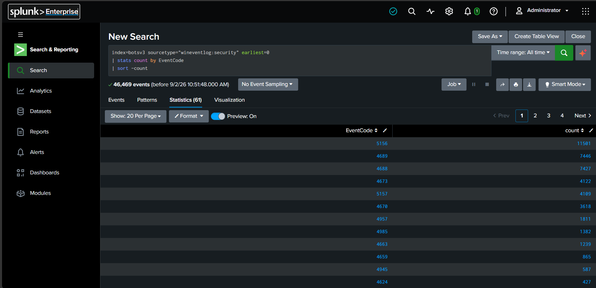
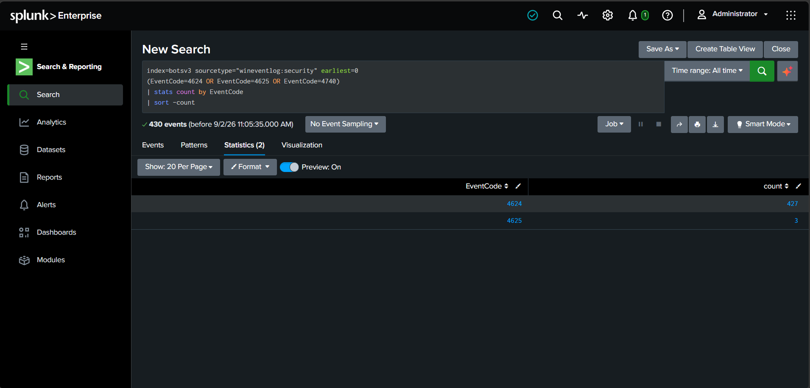
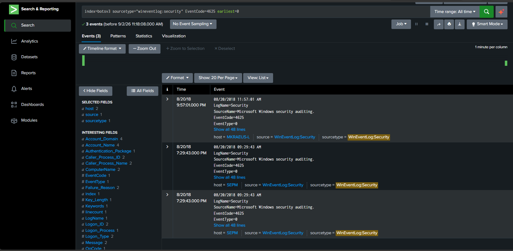
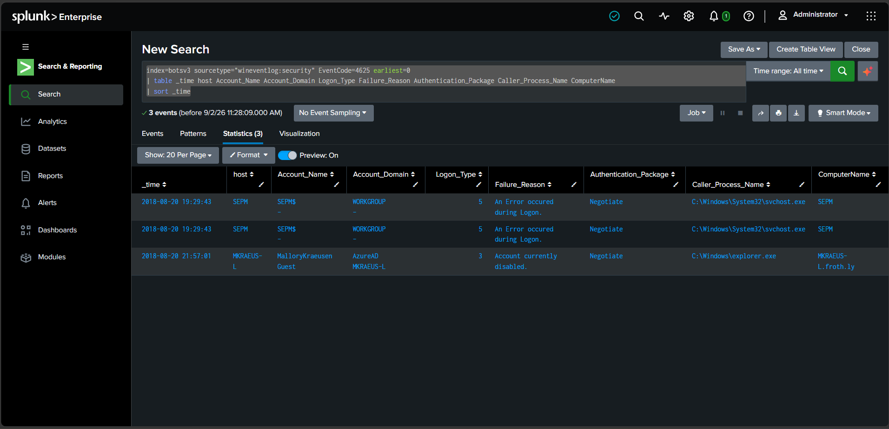
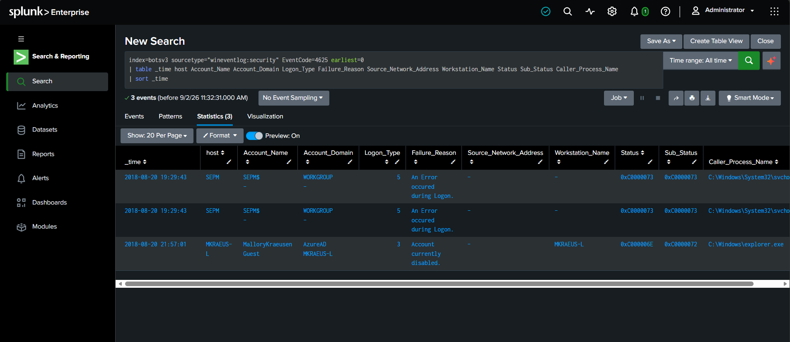
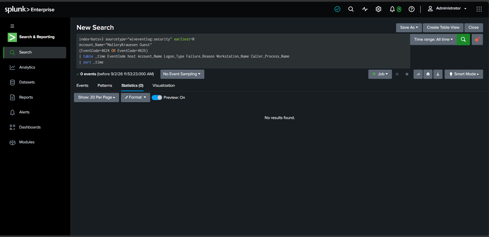
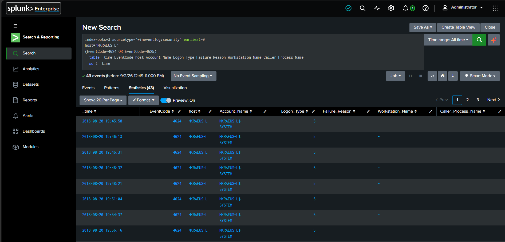
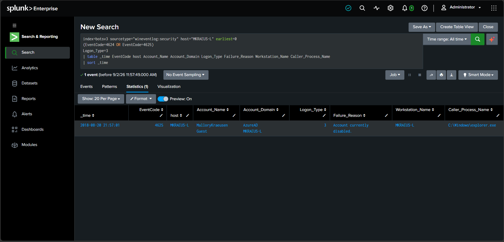

# Project 01 — Windows Authentication Investigation in Splunk

## Project Overview

This project investigates Windows authentication activity in the Splunk BOTS v3 dataset using Windows Security event logs.

The goal was to determine whether the observed authentication failures were consistent with credential attacks, brute-force activity, or successful account compromise. The investigation followed a SOC-style workflow: establish the available telemetry, identify failed authentication events, inspect their context, pivot on relevant entities, correlate successful and failed logons, and reach a defensible disposition.

## Investigation Objective

Identify authentication-related Windows Security events in the BOTS v3 dataset and determine whether any activity indicates:

- Repeated credential guessing
- Brute-force authentication
- Account lockout activity
- Successful authentication following failures
- Evidence of account compromise

## Why This Investigation Matters

Failed authentication events are common in enterprise environments and can result from user error, disabled accounts, service issues, misconfiguration, or genuine credential attacks.

The purpose of this investigation was not simply to locate Event ID `4625`, but to determine whether the failures formed a pattern consistent with malicious activity.

A SOC analyst must be able to distinguish normal authentication noise from activity that requires escalation. That means examining volume, user context, logon type, source, process, timing, and whether a failed attempt is followed by successful access.

## Data Source

- **SIEM:** Splunk Enterprise
- **Dataset:** BOTS v3
- **Index:** `botsv3`
- **Sourcetype:** `wineventlog:security`
- **Primary Event IDs:** `4624`, `4625`, `4740`

## Investigation Methodology

```text
Understand Windows Security Telemetry
        ↓
Review Authentication Event Volume
        ↓
Identify Failed Logons
        ↓
Inspect User / Host / Logon Type / Failure Reason
        ↓
Determine Whether Failures Are Related
        ↓
Pivot on Suspicious Account or Host
        ↓
Correlate Failed and Successful Logons
        ↓
Validate Network Logon Activity
        ↓
Determine Scope and Impact
        ↓
SOC Disposition
```

---

## 1. Windows Security Event Inventory

The first step was to understand which Windows Security Event IDs were present in the dataset.

```spl
index=botsv3 sourcetype="wineventlog:security" earliest=0
| stats count by EventCode
| sort -count
```



### Analyst Reasoning

Before focusing on failed logons, I wanted to understand the overall Windows Security telemetry available in the dataset.

This provides context for later pivots and confirms that the dataset contains authentication, process, privilege, and network-related Windows events that could be used if the investigation escalated.

---

## 2. Authentication Event Baseline

The investigation then focused on the main authentication-related Event IDs:

- `4624` — Successful logon
- `4625` — Failed logon
- `4740` — Account lockout

```spl
index=botsv3 sourcetype="wineventlog:security" earliest=0
(EventCode=4624 OR EventCode=4625 OR EventCode=4740)
| stats count by EventCode
| sort -count
```



### Results

- **427** successful logons — Event ID `4624`
- **3** failed logons — Event ID `4625`
- **0** account lockouts — Event ID `4740`

### Analyst Reasoning

Only three failed logons were present. That is not enough to classify the activity as brute force.

A credential attack would normally be supported by a pattern such as:

```text
Repeated 4625 failures
        ↓
Same user / source / host
        ↓
High volume or short time interval
        ↓
Potential 4624 success
        ↓
Privilege / process / network activity
```

The three failed logons therefore needed to be inspected individually rather than treated as an attack based on event count alone.

---

## 3. Isolating Failed Logons

The failed authentication events were isolated using:

```spl
index=botsv3 sourcetype="wineventlog:security" EventCode=4625 earliest=0
```



When reviewing failed logons, the main questions were:

- **Who** failed to log on?
- **Where** did the attempt originate?
- **Which host** was involved?
- **When** did it occur?
- **How** was the logon attempted?
- **Why** did authentication fail?
- **Which process** initiated the authentication?
- **Were the events related?**
- **Did successful authentication occur afterwards?**

This distinction matters because several isolated failures can be benign, while repeated failures followed by successful access can indicate credential compromise.

---

## 4. Failed Logon Context

The relevant authentication fields were displayed together to compare the three failures.

```spl
index=botsv3 sourcetype="wineventlog:security" EventCode=4625 earliest=0
| table _time host Account_Name Account_Domain Logon_Type Failure_Reason Authentication_Package Caller_Process_Name ComputerName
| sort _time
```



### Events 1 and 2 — `SEPM$`

The first two events showed:

- **Host:** `SEPM`
- **Account:** `SEPM$`
- **Domain:** `WORKGROUP`
- **Logon Type:** `5` — Service
- **Authentication Package:** `Negotiate`
- **Caller Process:** `svchost.exe`
- **Timestamp:** Same second
- **Failure:** `An Error occurred during Logon`

### Assessment

These events did not appear consistent with password guessing.

The account name ends in `$`, which is characteristic of a computer or machine account. Logon Type `5` represents a service logon, and `svchost.exe` is a normal Windows service-hosting process.

The combination of:

- Machine account
- Service Logon Type `5`
- `svchost.exe`
- No suspicious source address
- No repeated interactive credential attempts

was more consistent with a **service-related authentication issue** than a credential attack.

**Current assessment:** Likely benign/service-related failures based on the available evidence.

---

## 5. Detailed Review of the Third Failure

The third event was more noteworthy because it involved a network logon against a disabled account.

The search was expanded to include source, workstation, and Windows status fields:

```spl
index=botsv3 sourcetype="wineventlog:security" EventCode=4625 earliest=0
| table _time host Account_Name Account_Domain Logon_Type Failure_Reason Source_Network_Address Workstation_Name Status Sub_Status Caller_Process_Name
| sort _time
```



### Event 3

- **Host:** `MKRAEUS-L`
- **Account:** `MalloryKrauesen Guest`
- **Domain:** `AzureAD`
- **Logon Type:** `3` — Network
- **Failure Reason:** `Account currently disabled`
- **Workstation:** `MKRAEUS-L`
- **Caller Process:** `explorer.exe`
- **Sub Status:** `0xC0000072`

The sub-status was consistent with a disabled-account condition.

### Analyst Reasoning

A network logon attempt against a disabled account is worth investigating, but it is not automatically malicious.

At this point:

- There was only one such attempt.
- No repeated guessing pattern was visible.
- The account was disabled.

The next question was therefore:

> Did this Guest account ever successfully authenticate?

---

## 6. Account Pivot

The first pivot attempted to correlate successful and failed authentication events for the Guest account.

```spl
index=botsv3 sourcetype="wineventlog:security" earliest=0
Account_Name="MalloryKrauesen Guest"
(EventCode=4624 OR EventCode=4625)
| table _time EventCode host Account_Name Logon_Type Failure_Reason Workstation_Name Caller_Process_Name
| sort _time
```



### Result

The exact account-name search returned **0 events**, even though the earlier failed-logon search had confirmed that the `4625` event existed.

This suggested that the exact `Account_Name` value was not matching the extracted field as expected, potentially because of field parsing or formatting.

### Analyst Reasoning

A failed pivot does not mean the investigation stops.

If one entity is unreliable, another known entity can be used:

```text
Account → Host → IP → Time → Process
```

The associated host was therefore used as the next pivot.

---

## 7. Host Pivot

The investigation pivoted to host `MKRAEUS-L` and reviewed successful and failed authentication activity.

```spl
index=botsv3 sourcetype="wineventlog:security" earliest=0
host="MKRAEUS-L"
(EventCode=4624 OR EventCode=4625)
| table _time EventCode host Account_Name Logon_Type Failure_Reason Workstation_Name Caller_Process_Name
| sort _time
```



### Result

The search returned **43 authentication events** associated with `MKRAEUS-L`.

Most of the successful logons visible were:

- Event ID `4624`
- Logon Type `5` — Service
- Accounts such as `MKRAEUS-L$` and `SYSTEM`

These appeared to be normal background service authentications and were not directly related to the Guest network logon under investigation.

### Analyst Reasoning

The suspicious event used Logon Type `3`, while most of the host's successful activity used Logon Type `5`.

The search therefore needed to be narrowed to **network logons only** so that unrelated service activity did not create noise.

---

## 8. Network Logon Validation

The host activity was filtered to Logon Type `3` and limited to successful and failed authentication events.

```spl
index=botsv3 sourcetype="wineventlog:security" host="MKRAEUS-L" earliest=0
(EventCode=4624 OR EventCode=4625)
Logon_Type=3
| table _time EventCode host Account_Name Account_Domain Logon_Type Failure_Reason Workstation_Name Caller_Process_Name
| sort _time
```



### Result

Only one Logon Type `3` authentication event was identified:

- Event ID `4625`
- Account: `MalloryKrauesen Guest`
- Account status: Disabled
- No corresponding successful Event ID `4624` network logon

No repeated network authentication attempts were observed.

No successful network authentication associated with the Guest account or this network-logon activity was identified.

---

## Investigation Conclusion

**No brute-force activity identified and no evidence of successful account compromise was found.**

Three failed logons were identified in the Windows Security telemetry:

1. Two failures involved the `SEPM$` machine account using Logon Type `5` and `svchost.exe`. These were consistent with service-related authentication failures.
2. One failure involved a disabled Azure AD Guest account using Logon Type `3`.

Further correlation against `MKRAEUS-L` found no successful Logon Type `3` authentication and no repeated credential-guessing pattern.

The available evidence therefore does not support classification as brute-force activity or successful account compromise.

## SOC Disposition

**Disposition:** Likely Benign  
**Severity:** Low  
**Escalation Required:** No  
**Confirmed Compromise:** No

### Recommended SOC Action

Close as likely benign based on the available telemetry and monitor for recurrence or related authentication activity.

If similar activity recurred in a production environment, additional investigation should focus on:

- Repeated failures involving the same user or source
- Successful authentication following failures
- Privileged Event ID `4672` activity
- Explicit credential use with Event ID `4648`
- Suspicious process execution after authentication
- Network activity originating from the authenticated session

---

## Key Analyst Takeaways

- Event ID `4625` by itself does not prove brute force.
- Authentication investigations depend on **pattern, context, and correlation**.
- Logon Type provides important context for distinguishing service activity from user/network authentication.
- Machine accounts ending in `$` should not automatically be treated like interactive user accounts.
- Failed account pivots can be continued using another entity such as host, IP, time, or process.
- A successful `4624` must be interpreted in context; unrelated service logons do not prove the suspicious authentication succeeded.
- Filtering by Logon Type can remove large amounts of irrelevant authentication noise.
- SOC conclusions should state what the available evidence supports without overstating certainty.