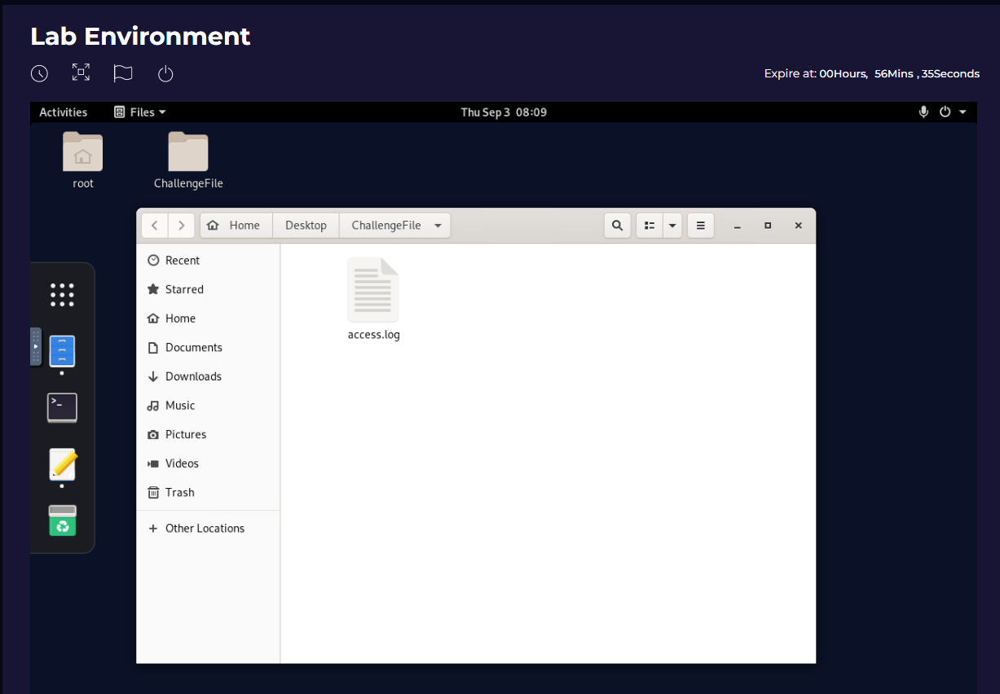
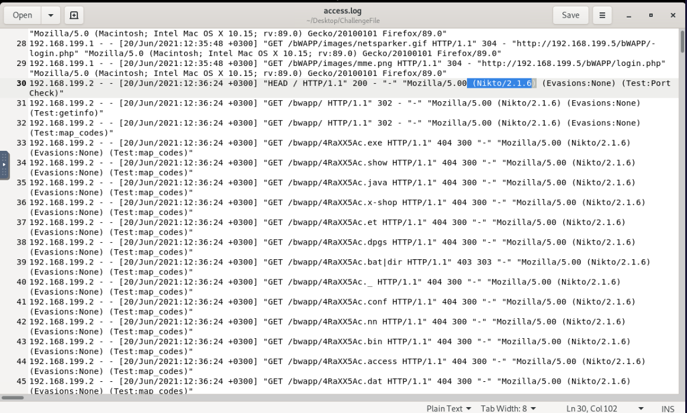
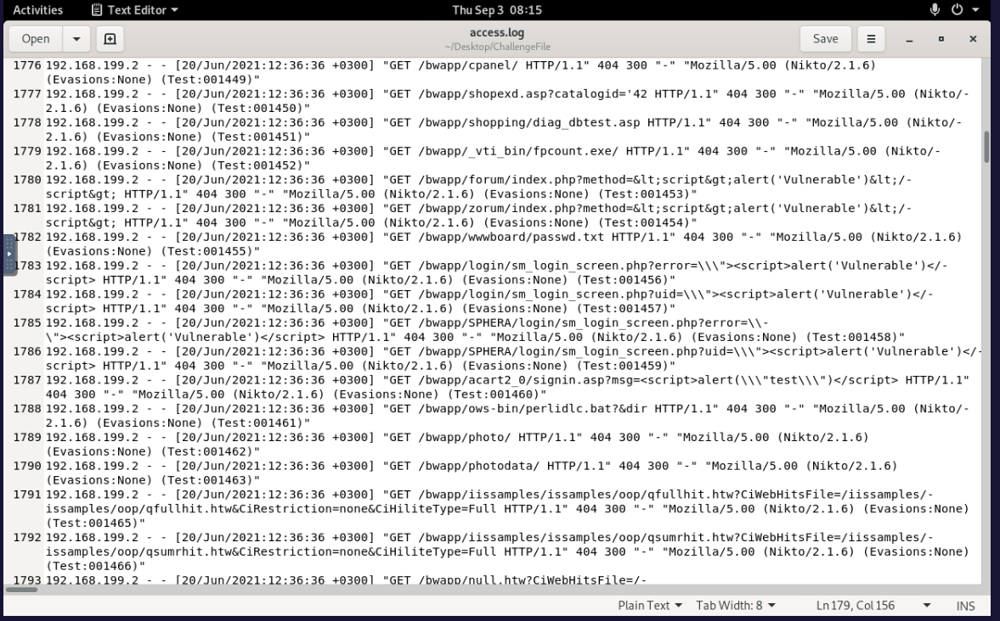
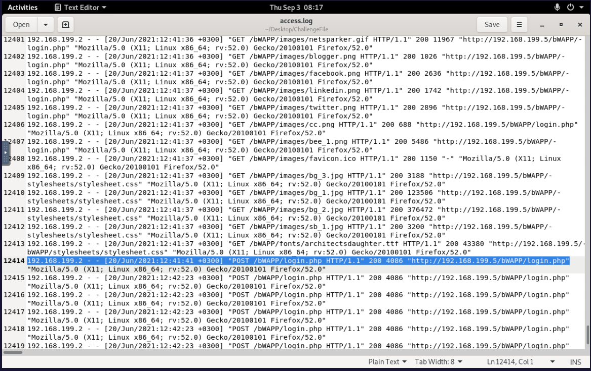
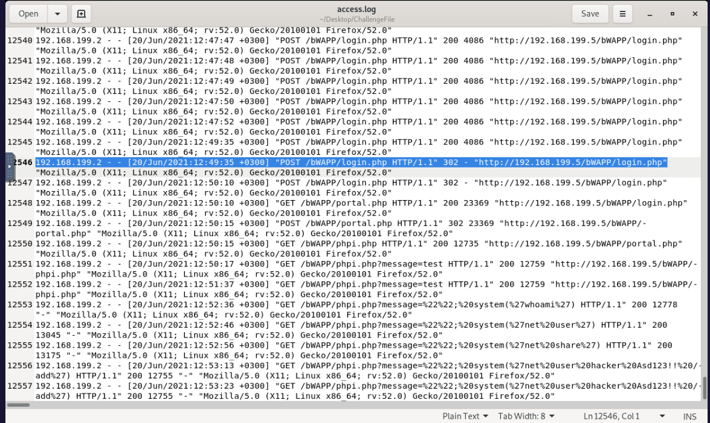
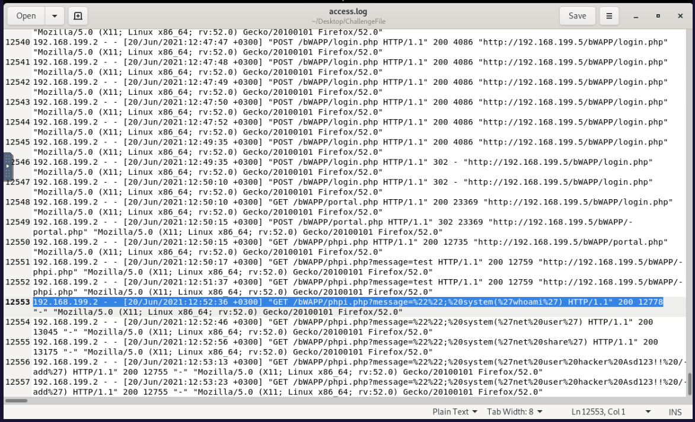
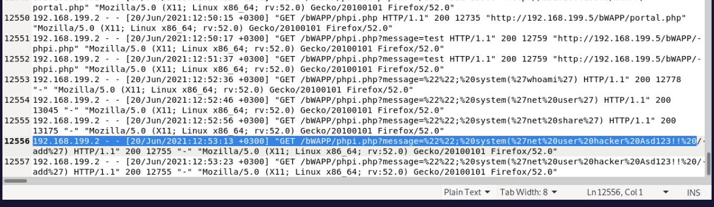

# Project 02 — Web Attack Investigation

## Project Overview

This project investigates a multi-stage web attack using the raw `access.log` provided in the LetsDefend **Investigate Web Attack** challenge.

Rather than treating each challenge question separately, I reconstructed the attack chronologically to understand:

- How the attacker performed reconnaissance
- How application directories were discovered
- What authentication attack followed
- Whether the authentication attack succeeded
- What the attacker did after gaining access
- Whether there was evidence of persistence

The investigation demonstrates how individual HTTP requests can appear ambiguous when viewed alone, but become meaningful when correlated as part of an attack sequence.

---

## Investigation Objective

Determine:

- The source of the malicious activity
- The reconnaissance tool used
- How directories were discovered
- The third attack technique
- Whether the authentication attack succeeded
- The fourth attack technique
- The first post-exploitation payload
- Whether persistence was attempted

---

## Data Source

- **Platform:** LetsDefend
- **Challenge:** Investigate Web Attack
- **Log Source:** Web Server Access Log
- **File:** `access.log`
- **Location:** `~/Desktop/ChallengeFile/access.log`
- **Attacker IP:** `192.168.199.2`
- **Victim Web Server:** `192.168.199.5`
- **Application:** bWAPP

---

## Lab Environment

The investigation began by locating the challenge `access.log` in the LetsDefend lab environment and opening it for manual analysis. Confirming the correct evidence source before analysis helps ensure that conclusions are based on the intended log data.



---

## Investigation Methodology

The investigation followed the activity chronologically:

```text
Understand Raw Web Logs
        ↓
Identify Suspicious Source
        ↓
Identify Reconnaissance
        ↓
Identify Directory Enumeration
        ↓
Identify Authentication Attack
        ↓
Determine Whether Authentication Succeeded
        ↓
Analyse Post-Authentication Activity
        ↓
Identify Code Injection
        ↓
Identify Persistence Attempt
        ↓
Reconstruct Attack Chain
        ↓
SOC Verdict
```

---

# Understanding the Access Log

Before searching for malicious behaviour, I first examined the structure of the web server log.

A normal entry looked similar to:

```text
192.168.199.1 - - [20/Jun/2021:12:35:40 +0300] "GET / HTTP/1.1" 200 2506 "-" "Mozilla/5.0 ..."
```

The important fields were:

| Field | Investigation Use |
|---|---|
| Source IP | Identifies who generated the request |
| Timestamp | Reconstructs the sequence of events |
| HTTP Method | Shows whether the request was GET, POST, etc. |
| Requested URI | Shows what resource was targeted |
| HTTP Status | Shows how the web application responded |
| Response Size | Helps compare application responses |
| Referrer | Provides additional request context |
| User-Agent | Can identify browsers or automated tools |

### Analyst Reasoning

Before classifying anything as malicious, I wanted to answer:

> Who generated the request, what did they request, how frequently did they request it, how did the server respond, and what happened immediately afterwards?

A single HTTP event usually provides limited context. The sequence of events is what allows an analyst to understand intent and impact.

The updated log view also shows the point where traffic changes from normal browser requests to requests from `192.168.199.2` using the `Nikto/2.1.6` User-Agent. This provided the first clear pivot from baseline web traffic into suspicious automated activity.



---

# Web Reconnaissance

While reviewing the log, a large number of requests were observed from:

```text
192.168.199.2
```

The User-Agent repeatedly contained:

```text
Mozilla/5.00 (Nikto/2.1.6)
```

The same source rapidly requested numerous different application paths and potentially vulnerable resources.

### Finding

**Reconnaissance Tool: Nikto 2.1.6**

Nikto is an automated web server scanner commonly used to identify exposed files, common vulnerabilities, default resources and server misconfigurations.

### Why This Was Suspicious

The evidence included:

- High request volume
- Many different application paths
- Requests occurring within seconds
- An explicit `Nikto/2.1.6` User-Agent
- Requests targeting potentially vulnerable resources

At this stage, there was evidence of malicious reconnaissance, but not yet evidence of successful compromise.

### Analyst Reasoning

The next question became:

> What did the attacker do after mapping the web application's attack surface?



---

# Directory Discovery and Authentication Attack

Following the reconnaissance activity, the attacker progressed through application enumeration and then began repeatedly targeting the bWAPP authentication endpoint.

Directory enumeration is identified through the behavioural pattern of one source rapidly requesting many different directory and file names rather than through a single request. The subsequent change to repeated requests against one login endpoint showed that the attacker had moved from discovery into an authentication attack.

The repeated login requests appeared as:

```text
POST /bWAPP/login.php HTTP/1.1" 200 4086
POST /bWAPP/login.php HTTP/1.1" 200 4086
POST /bWAPP/login.php HTTP/1.1" 200 4086
```

### Finding

**Directory Discovery:** Directory Brute Force / Directory Enumeration  
**Third Attack Type:** Brute Force

More specifically, the attacker was performing authentication brute forcing against the bWAPP login page.

### Evidence

- Same source IP
- Same `/bWAPP/login.php` endpoint repeatedly targeted
- Large number of HTTP `POST` requests
- Requests occurring rapidly
- Consistent response behaviour

### Analyst Reasoning

Repeated POST requests to a login page strongly suggest automated credential guessing. However, identifying the brute-force activity was only part of the investigation.

The next question was:

> Did any of the credentials actually work?



---

# Determining Whether the Brute Force Succeeded

Most of the login attempts returned:

```text
HTTP 200
Response Size: 4086
```

It would be incorrect to conclude that the attacker successfully authenticated simply because the server returned HTTP `200`.

## Why HTTP 200 Does Not Mean “Logged In”

HTTP `200 OK` means the server successfully processed and returned a response.

A login page can receive incorrect credentials, display an authentication failure message, and still respond with HTTP `200`.

Therefore:

> HTTP `200` does not prove successful authentication.

What matters is whether the application's behaviour changes.

## Response Behaviour Changed

Near the end of the brute-force activity, the repeated `200 4086` response pattern changed to:

```text
POST /bWAPP/login.php HTTP/1.1" 302
```

Shortly afterwards, the attacker accessed:

```text
/bWAPP/portal.php
```

### Why the 302 Was Important

HTTP `302` indicates that the application instructed the client to redirect to another location.

A common successful authentication flow is:

```text
POST /login
     ↓
Credentials accepted
     ↓
302 Redirect
     ↓
Authenticated page
```

The `302` response alone is still not absolute proof of successful authentication. The important evidence was the correlation:

```text
Repeated login attempts
        ↓
Repeated 200 / 4086 responses
        ↓
Response changes to 302
        ↓
Attacker accesses /bWAPP/portal.php
```

### Finding

**The brute-force attack was successful.**

The changed response behaviour combined with subsequent portal access provided significantly stronger evidence of successful authentication than the HTTP status code alone.

### Analyst Reasoning

The conclusion was not:

> `302 = successful attack`

Instead, the conclusion came from the sequence of events. Individual events can be ambiguous; correlation and timeline analysis provide context.



---

# Post-Authentication Activity — Code Injection

After gaining access to the application, the attacker began interacting with:

```text
/bWAPP/phpi.php
```

Initial requests included:

```text
/bWAPP/phpi.php?message=test
```

Shortly afterwards, the requests changed and began containing PHP `system()` calls.

One of the first malicious payloads contained:

```text
system('whoami')
```

### Finding

**Fourth Attack: Code Injection**  
**First Payload: `whoami`**

### Why `whoami` Matters

`whoami` identifies the account context under which a command is executing.

Attackers commonly use it after gaining command execution to answer:

> Did my payload execute, and which account am I currently running as?

This is a common post-exploitation validation technique.

### Post-Exploitation Discovery

Following the `whoami` request, additional commands appeared:

```text
net user
net share
```

`net user` can enumerate Windows user accounts, while `net share` can enumerate network shares. These commands are consistent with host-level discovery after compromise.

### Evidence Limitation

The access log proves that the malicious payloads were submitted to the application. A `200` response alone does not independently prove that the operating system successfully executed each command because the web access log does not contain the resulting command output.

The sequence of system-discovery and account-creation payloads, however, provides strong evidence of deliberate post-exploitation activity.



---

# Persistence Attempt

A later request contained:

```text
net user hacker Asd123!! /add
```

The command appeared inside the vulnerable application's `system()` call.

### What the Command Does

```text
net user hacker Asd123!! /add
```

attempts to create a new Windows local account:

```text
Username: hacker
Password: Asd123!!
```

### Persistence Assessment

This is a clear **persistence attempt**.

Instead of relying only on continued access through the vulnerable web application, the attacker attempted to create another account that could potentially be used to maintain access to the victim system.

### Important Distinction

The web access log confirms that the attacker submitted the account-creation command.

The log alone does not provide enough endpoint evidence to confirm that Windows successfully created the account.

Therefore, the most precise conclusion is:

> **Persistence was attempted through local account creation.**

Windows Security or endpoint telemetry would be required to independently verify whether the account was actually created.



---

# Reconstructed Attack Chain

```text
1. Web Reconnaissance
   └── Nikto 2.1.6
            ↓
2. Directory Discovery
   └── Directory Brute Force
            ↓
3. Authentication Attack
   └── Brute Force against /bWAPP/login.php
            ↓
4. Successful Authentication
   └── 302 redirect + /bWAPP/portal.php access
            ↓
5. Code Injection
   └── system('whoami')
            ↓
6. Host Discovery
   ├── net user
   └── net share
            ↓
7. Persistence Attempt
   └── net user hacker Asd123!! /add
```

---

# Challenge Findings

| Question | Finding |
|---|---|
| Which automated scan tool was used for web reconnaissance? | **Nikto 2.1.6** |
| Which technique was used for directory listing discovery? | **Directory Brute Force** |
| What was the third attack type? | **Brute Force** |
| Was the third attack successful? | **Yes** |
| What was the fourth attack? | **Code Injection** |
| What was the first payload for the fourth attack? | **`whoami`** |
| Was there a persistence clue? | **Yes** |
| Persistence payload | **`net user hacker Asd123!! /add`** |

---

# Key Findings

| Category | Finding |
|---|---|
| Attacker IP | `192.168.199.2` |
| Victim | `192.168.199.5` / bWAPP |
| Reconnaissance | Nikto 2.1.6 |
| Enumeration | Directory brute force |
| Credential Attack | Login brute force |
| Authentication Compromised | Yes |
| Evidence of Authentication Success | `302` redirect followed by portal access |
| Post-Authentication Attack | Code Injection |
| First Payload | `whoami` |
| Discovery Commands | `net user`, `net share` |
| Persistence | Local account creation attempted |
| Persistence Payload | `net user hacker Asd123!! /add` |

---

# Analyst Conclusion

Analysis of the web server access log identified a multi-stage attack originating from `192.168.199.2`.

The attacker initially performed automated web reconnaissance using Nikto and followed this activity with directory brute-force enumeration.

The attack then shifted to repeated `POST` requests against `/bWAPP/login.php`, consistent with authentication brute forcing.

The repeated HTTP `200` responses were not treated as evidence of successful authentication because an unsuccessful login can still produce a valid HTTP `200` response.

The significant change occurred when a login attempt produced an HTTP `302` redirect and was followed by access to `/bWAPP/portal.php`. Correlating these events provided evidence that the brute-force attack successfully obtained authenticated access.

After authentication, the attacker submitted code-injection payloads through `/bWAPP/phpi.php`, beginning with `whoami` and followed by `net user` and `net share`.

The attacker later submitted:

```text
net user hacker Asd123!! /add
```

indicating an attempt to establish persistent access through creation of a new local account.

Based on the available web telemetry, the investigation supports a **successful web application authentication compromise followed by post-exploitation code-injection activity and an attempted persistence mechanism**.

---

# SOC Disposition

**Classification:** True Positive  
**Severity:** High / Critical  
**Successful Authentication Compromise:** Yes  
**Post-Exploitation Activity:** Observed  
**Persistence Attempt:** Yes  
**Escalation Required:** Yes

## Recommended SOC Action

This incident would require immediate escalation in a production environment.

Recommended actions include:

- Isolate the affected web server.
- Investigate whether the `hacker` account was successfully created.
- Disable and remove any unauthorised accounts.
- Reset credentials associated with the compromised application.
- Review authentication logs for additional compromised credentials.
- Review endpoint telemetry for confirmation of command execution.
- Investigate additional persistence mechanisms.
- Review network activity for lateral movement.
- Block the malicious source where appropriate.
- Remediate the vulnerable web application.
- Preserve relevant web, authentication and endpoint logs for forensic analysis.

---

# Analyst Takeaways

- A single HTTP event rarely provides enough context to determine compromise.
- HTTP `200` means the request was successfully handled; it does **not** automatically mean a login or exploit succeeded.
- A `302` redirect also should not be interpreted in isolation; its significance came from the surrounding authentication timeline and subsequent portal access.
- Repeated POST requests against one authentication endpoint can indicate credential brute forcing.
- Consistent response sizes can help establish a baseline for failed login behaviour.
- User-Agent values can expose automated reconnaissance tools.
- Directory brute forcing is identified through patterns across many requests rather than a single event.
- `whoami` is commonly used to validate command-execution context.
- `net user` and `net share` indicate host-level discovery.
- Creation of a new account is a strong persistence indicator.
- Raw web logs may show that a command payload was submitted, but endpoint telemetry may still be required to prove that the operating-system command executed successfully.
- Reconstructing the chronological attack chain provides stronger evidence than analysing individual log entries in isolation.