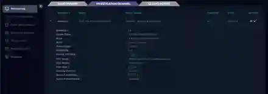

# SOC104 — Malware Detected

  

## Overview

This investigation began with a **medium-severity malware alert** for `winrar600.exe` on endpoint `SusieHost` (`172.16.17.5`). The security control detected the file but reported **Device Action: Allowed**, so the alert still required validation.

The objective was to determine whether the file was malicious, legitimate software incorrectly detected, or inconclusive because of missing telemetry.

## Alert Summary

| Field | Value |
|---|---|
| Rule | `SOC104 - Malware Detected` |
| File | `winrar600.exe` |
| MD5 | `c74862e16bcc2b0e02cadb7ab14e3cd6` |
| Host | `SusieHost` |
| Source IP | `172.16.17.5` |
| Device Action | Allowed |
| MITRE | `T1204` — User Execution |



## Investigation Approach

```text
Alert validation
    ↓
Hash / reputation
    ↓
Endpoint execution context
    ↓
Download / proxy context
    ↓
File metadata and signature
    ↓
Verdict
```

The endpoint agent was down, which meant process execution could not be independently confirmed. I therefore avoided claiming execution based only on the alert.

## Key Evidence

VirusTotal showed the sample matching the exact MD5 with a very low detection ratio. File metadata identified a WinRAR SFX installer and a valid digital signature from **win.rar GmbH**. Proxy telemetry also showed access to the official WinRAR post-download page.


## Findings

- Exact file hash matched the investigated sample.
- Very low multi-engine detection ratio.
- File metadata was consistent with WinRAR 6.0.0.
- Digital signature was valid and issued to `win.rar GmbH`.
- Proxy context pointed to the official WinRAR website.
- Endpoint execution telemetry was unavailable because the agent was down.

## Final Disposition

**False Positive — Legitimate WinRAR Installer**

The file was not quarantined, and execution could not be independently confirmed. The available evidence strongly supported legitimate software rather than malware.

## Skills Demonstrated

`Malware Alert Triage` · `Hash Analysis` · `VirusTotal` · `Digital Signatures` · `Proxy Correlation` · `False-Positive Analysis` · `Telemetry Limitations`
