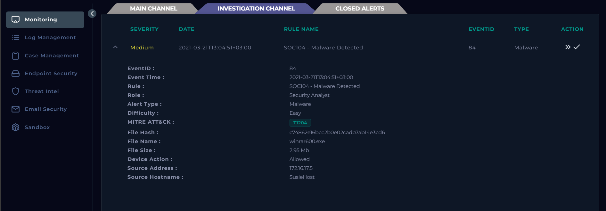
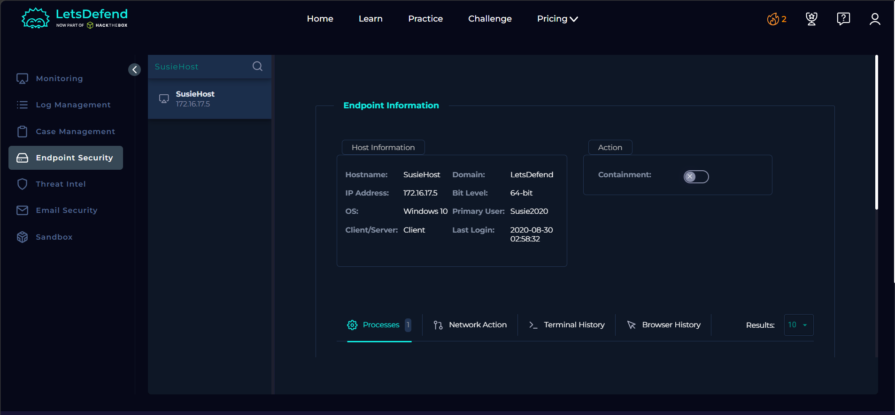
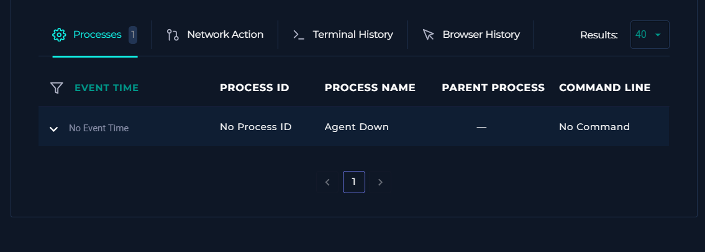
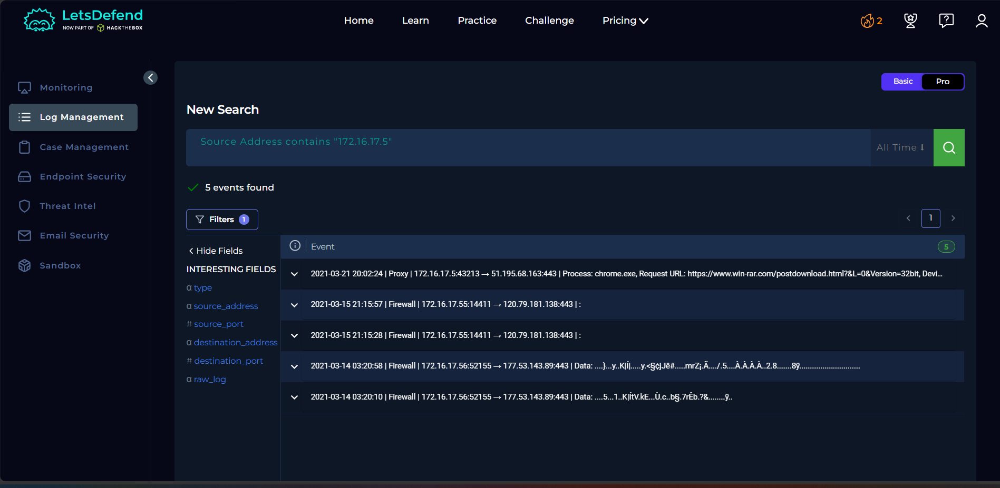
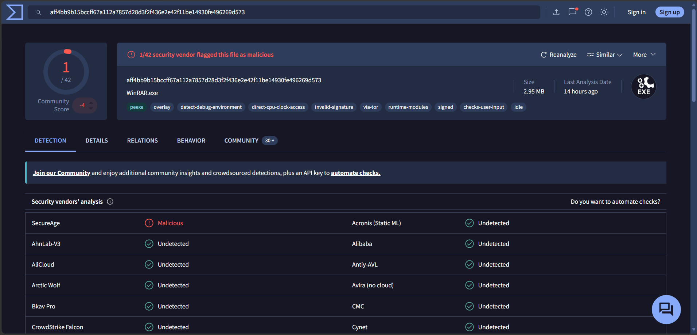
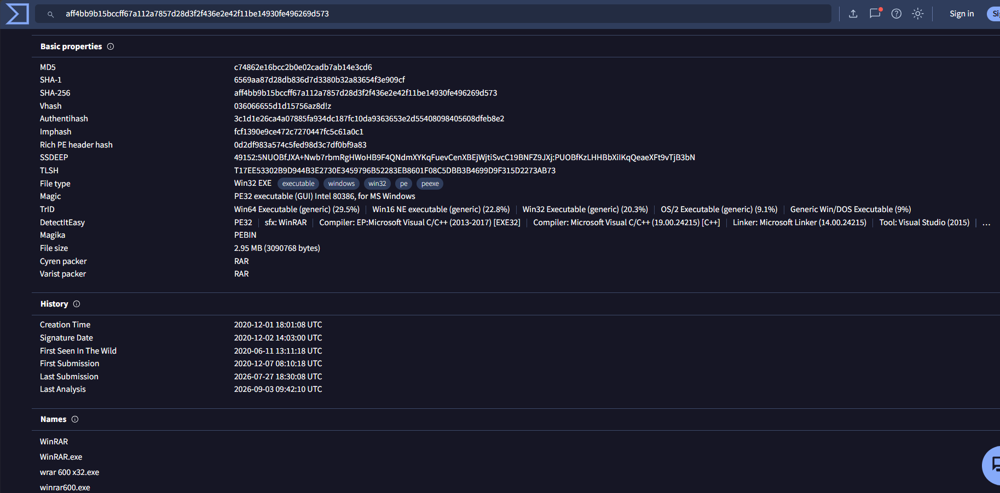
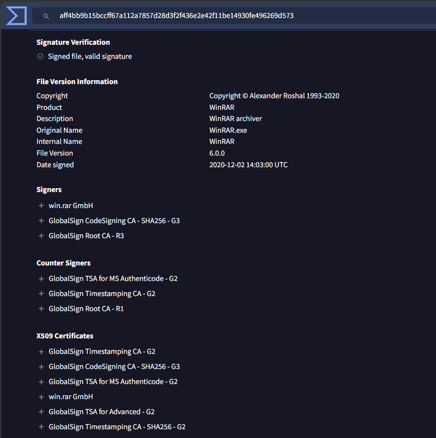

# SOC104 — Malware Detected

## Endpoint Malware Alert Investigation

### Case Summary

This investigation began with a **SOC104 — Malware Detected** alert for `winrar600.exe` on endpoint `SusieHost` (`172.16.17.5`). The security control detected the file but the **Device Action was Allowed**, meaning the alert still required analyst validation.

The objective was not to assume the file was malicious because an alert fired. The objective was to determine whether the alert represented:

- a true malicious file,
- a legitimate application incorrectly detected as malware,
- or an inconclusive event requiring escalation because of missing telemetry.

The investigation used alert metadata, threat intelligence, endpoint context, log/proxy telemetry, and VirusTotal file validation.

---

## Initial Alert

The alert provided the following starting evidence:

| Field | Value |
|---|---|
| Rule | `SOC104 - Malware Detected` |
| Severity | Medium |
| MITRE ATT&CK | `T1204` — User Execution |
| File | `winrar600.exe` |
| MD5 | `c74862e16bcc2b0e02cadb7ab14e3cd6` |
| File Size | 2.95 MB |
| Device Action | Allowed |
| Host | `SusieHost` |
| Source IP | `172.16.17.5` |



### Analyst Mindset

An alert is a **starting hypothesis**, not a verdict.

The first questions were:

1. **Is the file actually malicious?**
2. **Was it quarantined or allowed?**
3. **Did it execute?**
4. **Where did it come from?**
5. **Did it create suspicious processes or network activity?**
6. **Is there evidence of persistence or broader compromise?**
7. **Does the activity affect only one host or multiple systems?**

The filename `winrar600.exe` resembles legitimate WinRAR software, so both a malicious-file hypothesis and a false-positive hypothesis had to remain open until evidence was collected.

---

# Investigation Framework

The workflow used for this case can be reused for most endpoint malware alerts:

```text
Malware Alert
    ↓
Understand the Detection
    ↓
Check Quarantine / Device Action
    ↓
Validate File Hash / Reputation
    ↓
Identify Host + User
    ↓
Check Process Execution
    ↓
Check Browser / Download Origin
    ↓
Check Network / Proxy / Firewall Logs
    ↓
Validate URL / Domain / IP Reputation
    ↓
Validate File Metadata + Signature
    ↓
Check Persistence / Follow-on Activity
    ↓
Scope Across the Environment
    ↓
True Positive / False Positive / Inconclusive
    ↓
Contain, Escalate, or Close
```

The most important principle is:

> **Detection is not the same as compromise. The analyst must validate what happened and how much impact occurred.**

---

# 1. Check Whether the File Was Blocked or Quarantined

The original alert showed:

```text
Device Action: Allowed
```

This indicated the file was **not quarantined or blocked** by the security control.

### Why this matters

A malware alert can represent very different situations:

```text
Detected + Blocked
```

may mean malicious activity was prevented, while:

```text
Detected + Allowed
```

requires additional investigation because the file may have remained available to the user or system.

However, **Allowed does not prove the file executed**. Execution must be validated separately using endpoint/process telemetry.

---

# 2. Threat Intelligence Check

The alert MD5 was searched in LetsDefend Threat Intel:

```text
c74862e16bcc2b0e02cadb7ab14e3cd6
```

No threat-intelligence record was returned.

### Analyst Reasoning

A missing reputation result does **not** mean the file is safe.

It means only that the specific intelligence source has no information for that observable. The correct response is to pivot to another data source rather than classify the file as benign.

Useful reputation pivots for malware alerts include:

- **Hash:** VirusTotal, sandbox reports, internal threat intelligence
- **URL:** URLScan, URLhaus, VirusTotal
- **Domain:** WHOIS/domain age, VirusTotal, passive DNS, internal proxy history
- **IP:** VirusTotal, AbuseIPDB or another approved reputation source, internal firewall/proxy telemetry

Reputation should always be combined with host and behavioural context.

---

# 3. Identify the Affected Host and User

The alert was associated with:

```text
Hostname: SusieHost
IP: 172.16.17.5
OS: Windows 10 64-bit
Primary User: Susie2020
```



### Why host and user context matters

For any malware alert, determine:

- Which endpoint generated the alert?
- Which user is associated with the endpoint?
- Is the user privileged?
- Is the device a workstation or server?
- Is the system already contained?
- Are there other alerts involving the same host or user?

This creates the entities that can be used for later pivots:

```text
File → Hash → Host → User → IP → Process → Network → Other Hosts
```

---

# 4. Check Whether the File Executed

The next step was to review endpoint process telemetry to determine whether `winrar600.exe` actually ran.

The endpoint process view showed:

```text
Agent Down
No Event Time
No Process ID
No Parent Process
No Command Line
```



### Evidence Limitation

Because the endpoint agent was down, process telemetry could not confirm:

- whether `winrar600.exe` executed,
- which user launched it,
- its parent process,
- its command line,
- or whether it spawned suspicious child processes.

This must be documented as a telemetry limitation.

> **No telemetry is not evidence that nothing happened. It means the question cannot be answered from that data source.**

### What would normally be checked

If EDR telemetry were available, the process tree would be reviewed for activity such as:

```text
explorer.exe
  └── winrar600.exe
```

versus a suspicious chain such as:

```text
winword.exe
  └── powershell.exe
      └── winrar600.exe
```

The analyst should review:

- parent process,
- child processes,
- command line,
- execution path,
- user context,
- process hash,
- network connections,
- and file/registry changes.

---

# 5. Check Browser and Download Context

Endpoint browser history was also unavailable because the endpoint agent was down. Therefore the investigation pivoted to centralized Log Management instead of stopping.

### SOC Pivot Principle

When one telemetry source is unavailable, pivot using another known entity:

```text
Host → IP → Proxy Logs → URL → Domain → File Context
```

This is an important SOC workflow: analysts should not abandon an investigation simply because one data source is missing.

---

# 6. Log Management / Proxy Investigation

Log Management was searched for the exact host IP:

```text
172.16.17.5
```

Partial matches such as `172.16.17.55`, `.56`, and `.57` were ignored because they were different systems.

A relevant proxy event was identified for the same host and date:

```text
Source: 172.16.17.5
Destination: 51.195.68.163:443
Process: chrome.exe
Request URL: https://www.win-rar.com/postdownload.html?&L=0&Version=32bit
```



### Analyst Reasoning

This was an important contextual finding because:

- the alerted file was named `winrar600.exe`,
- the affected endpoint accessed the official `win-rar.com` site,
- the activity was generated by `chrome.exe`,
- and the URL was a WinRAR post-download page.

This strengthened the benign hypothesis that the user intentionally downloaded WinRAR.

However, the proxy event alone was **not treated as proof** that the alerted executable came from that page. It was supporting provenance/context evidence that needed to be combined with file validation.

### General log checks for malware investigations

Centralized log sources can help answer questions when endpoint telemetry is limited:

- **Proxy logs:** download URLs, domains, HTTP methods, user agents
- **Firewall logs:** outbound destinations, ports, repeated connections
- **DNS logs:** domains resolved before/after execution
- **Web gateway logs:** file downloads, blocked/allowed requests
- **Authentication logs:** unusual account activity around execution
- **SIEM correlation:** related alerts on the same host, user, hash, IP, or domain

---

# 7. External File Reputation — VirusTotal

The exact file was then validated in VirusTotal.

VirusTotal showed:

```text
1 / 42 security vendors flagged the file as malicious
File: WinRAR.exe
Size: 2.95 MB
```



### Why one detection was not enough to classify the file as malware

A single vendor detection can be a false positive. Reputation must be interpreted together with:

- number of detections,
- file identity,
- digital signature,
- known filenames,
- file metadata,
- observed behaviour,
- download origin,
- and enterprise telemetry.

A low detection ratio does not automatically prove a file is safe, but in this case it supported further validation rather than immediate escalation.

---

# 8. Validate the Exact File Identity

VirusTotal file details confirmed that the MD5 matched the alert exactly:

```text
MD5: c74862e16bcc2b0e02cadb7ab14e3cd6
SHA-256: aff4bb9b15bccff67a112a7857d28d3f2f436e2e42f11be14930fe496269d573
File Size: 2.95 MB
File Type: Win32 PE executable
DetectItEasy: SFX: WinRAR
```

Known filenames included:

```text
WinRAR
WinRAR.exe
wrar600_x32.exe
winrar600.exe
```



### Analyst Note — filenames are weak evidence by themselves

VirusTotal also listed historical submission names that looked less trustworthy, including a filename referencing a crack site.

That did not override the stronger evidence because the **same exact hash** was being referenced. A file can be renamed without changing its contents or hash.

Therefore:

> **Filename alone should never be used as the primary malware verdict.**

Hash identity, signature, provenance, and behaviour are stronger indicators.

---

# 9. Validate the Digital Signature

The strongest legitimacy check came from the executable's signature information.

VirusTotal showed:

```text
Signed file, valid signature
Product: WinRAR
Description: WinRAR archiver
Original Name: WinRAR.exe
File Version: 6.0.0
Signer: win.rar GmbH
Certificate Chain: GlobalSign
```



### Why this matters

A valid Authenticode signature provides strong evidence that the binary was signed by the expected software publisher and had not been modified after signing.

Digital signatures should still be interpreted with context because malicious software can also be signed, but here the signature aligned with every other major finding:

```text
Alerted filename resembles WinRAR
        ↓
Exact alert hash matches VirusTotal
        ↓
File identified as WinRAR 6.0
        ↓
Only 1/42 detections
        ↓
Valid signature from win.rar GmbH
        ↓
Host accessed official win-rar.com page
```

This created a coherent legitimate-software explanation for the alert.

---

# 10. Malware Triage Questions to Ask Yourself

The following questions should be asked during almost every malware alert investigation.

## A. Is the alert really malicious?

Check:

- What detection rule fired?
- Was detection signature-based, reputation-based, behavioural, or ML-based?
- Does the hash have known malicious reputation?
- How many engines detect it?
- Does the file have a valid publisher signature?
- Is the filename consistent with the file metadata?

## B. Was the file blocked or quarantined?

Check:

- Device Action
- Antivirus/EDR remediation status
- quarantine events
- deletion/cleanup events

Possible outcomes:

```text
Malicious + Quarantined
Malicious + Allowed
Benign + Alerted
Unknown + Insufficient Telemetry
```

## C. Did the file execute?

Check:

- EDR process telemetry
- process tree
- parent/child relationships
- command line
- execution timestamp
- user context
- file path

Remember:

> **Allowed does not mean executed.**

## D. Where did the file come from?

Check:

- browser history
- proxy logs
- email attachments
- download URLs
- PowerShell or command-line downloads
- network shares
- USB/removable media
- software deployment systems

## E. Did it communicate externally?

Check:

- proxy logs
- firewall logs
- DNS logs
- EDR network connections
- URLs/domains/IPs from sandbox analysis

Then reputation-check those observables where appropriate.

## F. Did it create persistence or follow-on activity?

Check:

- scheduled tasks
- services
- Run/RunOnce registry keys
- startup folders
- new accounts
- DLL registration
- unusual child processes
- additional payload downloads

## G. What is the scope?

Search the environment for:

- same hash,
- same filename,
- same destination IP/domain,
- same URL,
- same parent/child process pattern,
- other alerts involving the same user or host.

The investigation should move from **one alert** to understanding whether there is a wider incident.

---

# Evidence Summary

| Evidence | Finding | Interpretation |
|---|---|---|
| Malware alert | `winrar600.exe` on `SusieHost` | Required validation |
| Device Action | Allowed | File was not quarantined/blocked |
| LetsDefend Threat Intel | No hash data | Reputation unknown from that source |
| Endpoint context | `SusieHost`, user `Susie2020` | Confirmed affected asset/user context |
| Process telemetry | Agent Down | Execution could not be independently verified |
| Browser telemetry | Agent Down | Local browser history unavailable |
| Proxy telemetry | Chrome accessed official `win-rar.com` post-download page | Strong benign provenance/context clue |
| VirusTotal | 1/42 detections | Weak evidence of maliciousness |
| Hash | Exact MD5 match | Same file as the alert |
| File identification | WinRAR 6.0 / WinRAR SFX | Consistent with legitimate software |
| Signature | Valid; `win.rar GmbH` | Strong legitimacy evidence |

---

# Final Assessment

**Verdict:** False Positive  
**File Classification:** Non-malicious / legitimate WinRAR installer  
**Containment Required:** No  
**Escalation Required:** No based on available evidence  
**Endpoint Execution Confirmed:** No — telemetry unavailable  

The `SOC104 - Malware Detected` alert was triggered for `winrar600.exe` on `SusieHost` (`172.16.17.5`). The file was allowed and was not quarantined.

The alerted MD5 was validated against VirusTotal and matched a WinRAR 6.0 installer with the same 2.95 MB file size. Only 1 of 42 security vendors flagged the sample. File metadata identified the executable as WinRAR, and the file had a **valid digital signature from `win.rar GmbH`**.

Proxy telemetry from `SusieHost` also showed `chrome.exe` accessing the official `win-rar.com` post-download page, supporting legitimate user download activity.

Endpoint process and browser telemetry could not be fully validated because the endpoint agent was down, so execution could not be independently confirmed. Despite this telemetry limitation, the available file identity, signature, reputation, and network-context evidence strongly supports classification of the detected executable as legitimate WinRAR software.

The alert was therefore closed as a **False Positive**.

---

# Key SOC Lessons

- An alert is a hypothesis, not a conclusion.
- Malware detections must be validated using multiple independent evidence sources.
- **Device Action: Allowed** does not prove execution.
- **No threat-intelligence result** does not mean benign.
- If endpoint telemetry is unavailable, pivot to centralized logs such as proxy, firewall, DNS, or SIEM data.
- A single antivirus detection should not outweigh stronger contradictory evidence without additional behavioural confirmation.
- File hashes are stronger identifiers than filenames.
- A valid publisher signature can be a powerful legitimacy indicator when it aligns with provenance and behaviour.
- Missing telemetry must be documented rather than interpreted as absence of malicious activity.
- The final SOC disposition should be based on the complete evidence chain, not one field or one tool.