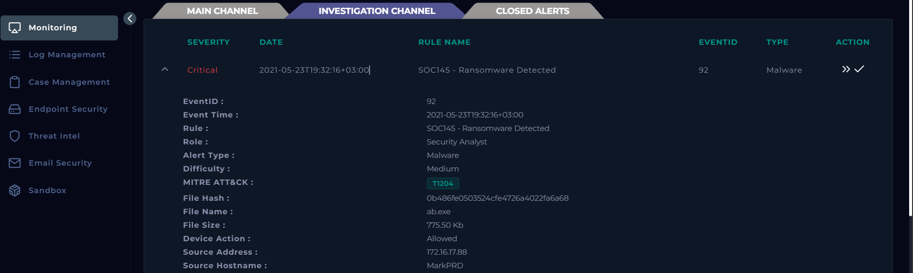
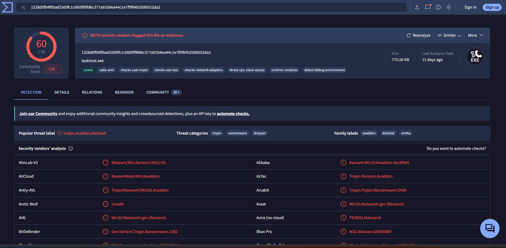
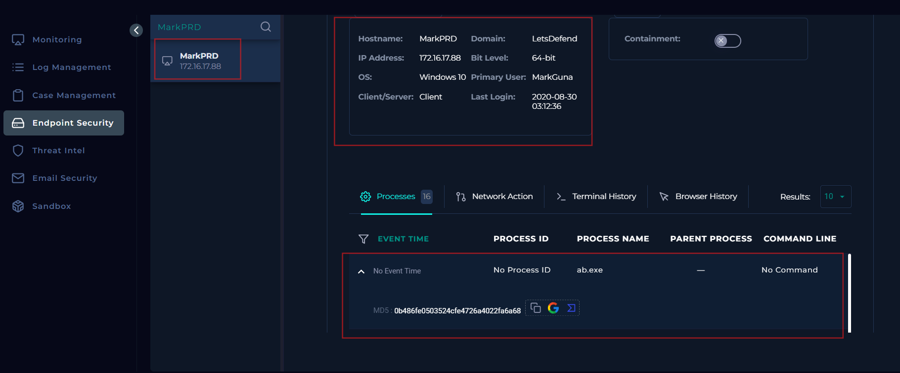
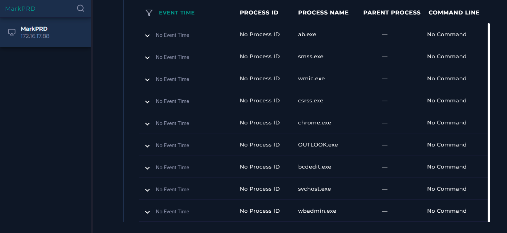
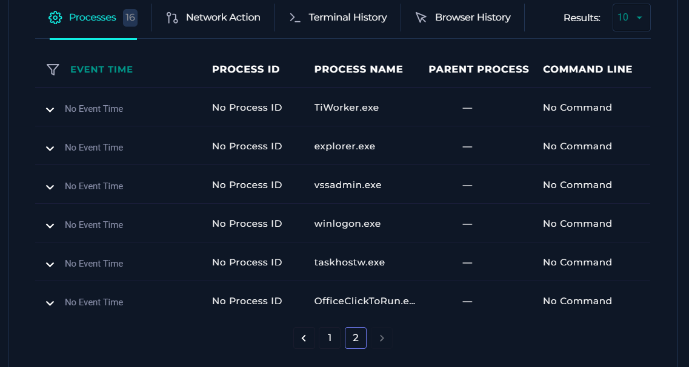
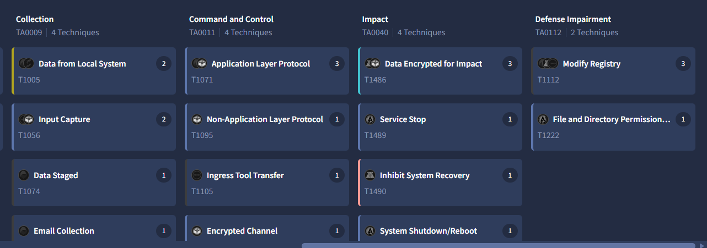

# SOC145 — Ransomware Detected

## Endpoint Ransomware Investigation | LetsDefend EventID 92

This project documents my investigation of a **Critical ransomware alert** involving `ab.exe` on the Windows endpoint `MarkPRD` (`172.16.17.88`).

The goal was not just to answer the LetsDefend playbook. I wanted to work the case like a SOC analyst: start from the alert, form questions, pivot into the right telemetry, separate confirmed evidence from assumptions, use external malware analysis only where it added context, and finish with a defensible verdict and response plan.

**Final verdict:** **True Positive — Critical Ransomware Incident**  
**Malware family:** Avaddon-associated ransomware  
**Endpoint:** `MarkPRD` / `172.16.17.88`  
**Device action:** Allowed / not quarantined  
**Escalation:** Required  
**Recommended containment:** Immediate endpoint isolation

> **Evidence note:** The LetsDefend and VirusTotal screenshots are from my investigation. The Hybrid Analysis and ANY.RUN screenshots later in this README are clearly marked as **external reference screenshots** from a public SOC145 walkthrough for the same case/sample. I use them as corroborating sandbox evidence and do not present them as screenshots I generated locally.

---

# 1. Start With the Alert

The investigation started with the alert itself, not with VirusTotal or a walkthrough.



## Alert Summary

| Field | Value |
|---|---|
| Rule | `SOC145 - Ransomware Detected` |
| Event ID | `92` |
| Severity | **Critical** |
| Event Time | `2021-05-23T19:32:16+03:00` |
| Alert Type | Malware |
| MITRE ATT&CK | `T1204` — User Execution |
| File | `ab.exe` |
| MD5 | `0b486fe0503524cfe4726a4022fa6a68` |
| File Size | `775.50 KB` |
| Device Action | **Allowed** |
| Source IP | `172.16.17.88` |
| Hostname | `MarkPRD` |

### My first reaction to the alert

The two fields that mattered most were:

```text
Critical severity
Device Action = Allowed
```

`Allowed` does **not** prove the ransomware successfully executed, but it tells me I cannot assume the security control stopped it. That immediately changes the investigation from "identify a suspicious file" to:

> **Is this really ransomware, and if it was allowed, did it execute and cause impact?**

---

# 2. Analyst Question Framework

I used the following questions to control the investigation instead of randomly clicking through tools:

| Question | Why I asked it | Evidence needed |
|---|---|---|
| **1. Is the file actually malicious?** | Alert names can be wrong or false positives | Exact-hash reputation / malware analysis |
| **2. Was it blocked or quarantined?** | A blocked sample is a different incident from one allowed to run | Device action / EDR response |
| **3. Did it execute?** | Malicious file on disk ≠ successful execution | Endpoint process telemetry |
| **4. What happened around execution?** | Context can reveal ransomware tooling and impact | Full process list, parent/child, commands |
| **5. Did it inhibit recovery?** | Ransomware often destroys recovery options | `vssadmin`, `wmic`, `wbadmin`, `bcdedit`, commands |
| **6. Did it encrypt files / create a ransom note?** | Determines actual ransomware impact | File activity / sandbox behavior |
| **7. Did it communicate externally?** | Helps identify C2, download, exfiltration, or infrastructure | Network / proxy / DNS / sandbox |
| **8. How did it arrive?** | Needed for root cause and prevention | Email, browser, download, endpoint telemetry |
| **9. Is another host affected?** | Ransomware scope determines urgency and containment | EDR/XDR-wide search / correlated alerts |
| **10. What response is required?** | Investigation must lead to action | Verdict + scope + impact |

My working flow became:

```text
Alert
  ↓
Validate file
  ↓
Check block/quarantine status
  ↓
Confirm execution
  ↓
Inspect FULL endpoint process context
  ↓
Look for recovery inhibition / encryption indicators
  ↓
Check network + browser + email + logs
  ↓
Use sandbox analysis to close evidence gaps
  ↓
Scope environment
  ↓
Verdict → Contain → Escalate → Document
```

---

# 3. Question 1 — Is `ab.exe` Really Malicious?

## Observation

The alert gave me a filename and MD5:

```text
ab.exe
0b486fe0503524cfe4726a4022fa6a68
```

The filename alone is weak evidence. Malware can be renamed and legitimate programs can also have strange names.

## Why I pivoted to the hash

A cryptographic hash identifies the content of the sample rather than relying on its filename. I searched the exact MD5 in VirusTotal.



## Finding

VirusTotal showed approximately **60/70 detections**, with labels including:

```text
Avaddon
Ransomware
Trojan
Dropper
```

The sample mapped to SHA-256:

```text
1228d0f04f0ba82569fc1c0609f9fd6c377a91b9ea44c1e7f9f84b2b90552da2
```

### Decision

**The exact alerted sample is malicious and strongly associated with Avaddon ransomware.**

This was not a borderline reputation result. The next question became whether the security control stopped it.

---

# 4. Question 2 — Was It Blocked or Quarantined?

## Observation

The alert showed:

```text
Device Action: Allowed
```

The LetsDefend playbook/endpoint context also did not show the malware as quarantined.

## Why this matters

There is a major difference between:

```text
Malicious + Blocked
```

and:

```text
Malicious + Allowed
```

An allowed ransomware sample must be treated as potentially active until execution and impact are investigated.

### Decision

**Not quarantined / not blocked by the control represented in the alert.**

Next question:

> **Did `ab.exe` actually execute on `MarkPRD`?**

---

# 5. Question 3 — Did `ab.exe` Execute?

I pivoted to **Endpoint Security** and searched the affected host.



## Observation

Host context:

```text
Hostname: MarkPRD
IP: 172.16.17.88
OS: Windows 10 64-bit
Primary User: MarkGuna
```

The endpoint process list contained:

```text
ab.exe
```

with the same malicious MD5 associated with the alert.

## Why this matters

A malicious file being present is not enough to say it ran. Seeing `ab.exe` represented as a process gives host-side evidence supporting execution.

## Evidence limitation

LetsDefend did **not** give me:

```text
Event time
PID
Parent process
Command line
```

So I could not reconstruct an exact execution tree or claim a specific parent process.

### Decision

**Execution is supported by the endpoint process observation, but the execution context is incomplete.**

---

# 6. The Investigation Mistake I Made — and Why It Matters

One useful lesson from this case was my investigation order.

After validating the file as malicious, I moved into **VirusTotal behavior/sandbox analysis too early**. VirusTotal was useful, but I had not yet fully exhausted the endpoint evidence already available in LetsDefend.

That was the sequencing mistake.

## What I should have done first

After seeing `ab.exe`, I should have immediately asked:

> **What else is running on this host, and are there processes that make sense in a ransomware attack?**

When I returned to the **full process list**, that became one of the strongest parts of the entire investigation.

### Corrected workflow

```text
Alert
↓
Validate malicious file
↓
Check allowed/quarantine status
↓
Endpoint execution
↓
FULL process review          ← I should exhaust this earlier
↓
External enrichment / sandbox
```

### Lesson

> **Threat intelligence is enrichment. It should not replace host investigation.**

VirusTotal can tell me what a sample is known to do. Endpoint telemetry tells me what was actually observed on the affected system.

---

# 7. Question 4 — What Else Was Running on `MarkPRD`?

I reviewed every process available in the endpoint view instead of focusing only on `ab.exe`.



The second page revealed another important process:



## Processes that stood out

```text
wmic.exe
bcdedit.exe
wbadmin.exe
vssadmin.exe
```

These are legitimate Windows utilities. Their names alone do not make them malicious.

But in a confirmed ransomware context they are highly relevant:

| Process | Legitimate purpose | Why I care during ransomware triage |
|---|---|---|
| `wmic.exe` | Windows Management Instrumentation CLI | Can manipulate shadow copies/system configuration |
| `vssadmin.exe` | Volume Shadow Copy administration | Can delete Volume Shadow Copies |
| `bcdedit.exe` | Boot configuration | Can alter Windows recovery behavior |
| `wbadmin.exe` | Windows Backup | Can manipulate/delete backups |

## Evidence discipline

At this stage I **could not** truthfully write:

> "`vssadmin.exe` deleted all shadow copies on MarkPRD."

Why? Because the LetsDefend process view showed **no command lines, timestamps or parent-child relationships**.

The correct statement was:

> **Recovery-related Windows utilities were observed alongside confirmed ransomware execution. This is strongly suspicious and consistent with recovery-inhibition behavior, but the exact commands require additional evidence.**

That created a focused sandbox question:

> **Does this exact malware sample actually use these utilities to inhibit recovery?**

---

# 8. Question 5 — Network / C2 / Delivery Evidence

I checked the other available data sources to determine how the malware arrived and whether it communicated externally.

## Endpoint telemetry

- Network Action: no useful incident-time records
- Terminal History: no useful records
- Browser History: no useful records
- Email Security search for the associated user: no supporting email evidence found

## Log Management

Searching `172.16.17.88` exposed older proxy activity, including:

```text
Process: chrome.exe
URL: http://nuangaybantiep.xyz
Device Action: Allowed
Parent: explorer.exe
```

However, this event occurred on **2021-04-05**, while SOC145 fired on **2021-05-23**.

## Why I rejected the easy conclusion

The domain looked suspicious, but it was over a month away from the ransomware event. A suspicious domain on the same host is not automatically ransomware C2.

### Decision

```text
Incident-specific C2: NOT CONFIRMED
Initial delivery vector: UNKNOWN
```

This is an important SOC habit: **correlation needs time and behavioral context, not just a suspicious-looking IOC.**

---

# 9. Scope Check — Why the MD5 Search Returned Nothing

I searched Log Management for:

```text
0b486fe0503524cfe4726a4022fa6a68
```

and received no result.

That does **not** mean:

> "The ransomware only existed on MarkPRD."

The log source may simply not store or index file hashes. Proxy and firewall telemetry commonly expose IPs, URLs, ports and processes without an MD5 field.

### Decision

> **No centralized logs containing the MD5 were available, so enterprise scope could not be established through this hash search.**

In a real SOC I would scope the hash and behaviors using EDR/XDR telemetry across all endpoints.

---

# 10. Dynamic Analysis — Why a Sandbox Was Needed

At this point I knew:

```text
Exact file = ransomware
Device action = allowed
ab.exe = observed as a process
Recovery-related tools = observed on MarkPRD
```

But the endpoint lacked command lines and detailed file activity.

The purpose of dynamic analysis was therefore **not** simply to ask "is this malware?" again. It was to answer the missing behavioral questions:

```text
What does the sample do after execution?
Does it delete shadow copies?
Does it disable recovery?
Does it create a ransom note?
Does it encrypt/rename files?
What additional processes appear?
```

I prepared the LetsDefend Windows sandbox for manual analysis, including a baseline and process monitoring, but I did **not** complete a local detonation. For the final investigation I used existing public sandbox evidence for the same SOC145 sample and clearly separate that external evidence from what I personally observed on `MarkPRD`.

---

# 11. Hybrid Analysis — External Corroboration

A public SOC145 walkthrough for this same case shows Hybrid Analysis findings including:

- deletion of volume snapshots
- multiple spawned processes / persistence-related behavior
- file modification and ransom-note activity

> **External reference screenshot — Ryan Wachira SOC145 walkthrough. This is supporting reference evidence, not a screenshot generated in my local analysis.**


### Why this matters

The Hybrid Analysis result supports the hypothesis formed from the endpoint process list: the recovery-related utilities were not random background processes in the broader malware context. The sample demonstrates behavior associated with disrupting system recovery.

---

# 12. ANY.RUN — External Dynamic Analysis

The public walkthrough also shows the sample being detonated in **ANY.RUN**, with behavioral evidence including:

- `ab.exe` spawning processes such as `rundll32.exe` and `ShadowCopy.exe`
- brief PowerShell activity
- creation of a ransom-note file named `UZIZ8_readme_text`
- file encryption/ransomware behavior

These screenshots are used as **external reference evidence** for the same SOC145 sample.

### ANY.RUN Reference 1


### ANY.RUN Reference 2


### ANY.RUN Reference 3


### ANY.RUN Reference 4


## Correlation back to my endpoint evidence

The important part was not merely collecting more screenshots. It was connecting the sandbox behavior back to the evidence I had already found:

```text
MarkPRD endpoint                     External sandbox behavior
----------------                     -------------------------
ab.exe observed              →       exact ransomware sample behavior
wmic.exe observed            →       recovery / shadow-copy manipulation
bcdedit.exe observed         →       recovery configuration modification
wbadmin.exe observed         →       backup-recovery interference context
vssadmin.exe observed        →       volume-shadow-copy behavior
```

The sandbox evidence **corroborates** the endpoint findings. It does not let me pretend every sandbox action was directly logged on `MarkPRD`.

---

# 13. VirusTotal Behavioral / MITRE Validation

VirusTotal's aggregated sandbox behavior mapped the exact sample to several ransomware-relevant ATT&CK techniques.



The most important mappings were:

| Technique | ID | Why it matters |
|---|---|---|
| Data Encrypted for Impact | `T1486` | Core ransomware impact behavior |
| Inhibit System Recovery | `T1490` | Prevents or complicates restoration |
| Service Stop | `T1489` | Can stop services to facilitate impact or hinder recovery |

This gave me another independent source supporting the sample's destructive ransomware behavior.

---

# 14. Artifacts and Observations

The useful artifacts from the investigation are below. I separate **incident-observed artifacts** from artifacts seen only in external sandbox analysis.

| Artifact | Type | Source | Analyst interpretation |
|---|---|---|---|
| `0b486fe0503524cfe4726a4022fa6a68` | MD5 | LetsDefend + VirusTotal | Exact malicious file hash |
| `1228d0f04f0ba82569fc1c0609f9fd6c377a91b9ea44c1e7f9f84b2b90552da2` | SHA-256 | VirusTotal | Exact sample identity |
| `ab.exe` | File/process | LetsDefend endpoint | Alerted ransomware and observed process |
| `MarkPRD` | Host | LetsDefend | Affected endpoint |
| `172.16.17.88` | IP | LetsDefend | Affected endpoint address |
| `MarkGuna` | User | LetsDefend | Primary user associated with host |
| `wmic.exe` | Process | LetsDefend endpoint | Recovery/system-management tool suspicious in context |
| `bcdedit.exe` | Process | LetsDefend endpoint | Recovery/boot configuration tool suspicious in context |
| `wbadmin.exe` | Process | LetsDefend endpoint | Backup administration tool suspicious in context |
| `vssadmin.exe` | Process | LetsDefend endpoint | Shadow-copy administration tool suspicious in context |
| `ab.bin` | Original/related filename | External walkthrough | Reported original name before `ab.exe` execution |
| `rundll32.exe` | Process | External ANY.RUN reference | Observed during sandbox execution |
| `ShadowCopy.exe` | Process/artifact | External ANY.RUN reference | Recovery-related sandbox artifact |
| `UZIZ8_readme_text` | Ransom note | External ANY.RUN reference | Ransom note created after execution |

### Important exclusion

I did **not** promote `nuangaybantiep.xyz` into the final IOC list because I could not establish a reliable relationship between that April proxy event and the May ransomware alert.

---

# 15. Evidence Correlation

```text
SOC145 Critical Alert
        ↓
ab.exe + exact MD5 + MarkPRD
        ↓
Device Action = Allowed
        ↓
VirusTotal exact-hash validation
        ↓
Strong Avaddon/ransomware classification
        ↓
Endpoint pivot
        ↓
ab.exe observed as process
        ↓
Full process review
        ↓
wmic + bcdedit + wbadmin + vssadmin
        ↓
External Hybrid Analysis / ANY.RUN
        ↓
recovery inhibition + ransom-note / ransomware behavior
        ↓
VirusTotal behavior mapping
        ↓
T1486 Data Encrypted for Impact
T1490 Inhibit System Recovery
T1489 Service Stop
        ↓
TRUE POSITIVE — CRITICAL RANSOMWARE INCIDENT
```

---

# 16. MITRE ATT&CK Mapping

| Technique | ID | Evidence | Confidence |
|---|---|---|---|
| User Execution | `T1204` | Original LetsDefend alert | Alert-provided |
| Windows Management Instrumentation | `T1047` | `wmic.exe` + sandbox behavior | Supporting |
| Data Encrypted for Impact | `T1486` | VirusTotal / sandbox behavior | High for sample behavior |
| Inhibit System Recovery | `T1490` | Endpoint recovery tools + sandbox evidence | High |
| Service Stop | `T1489` | VirusTotal sandbox behavior | High for sample behavior |
| Modify Registry | `T1112` | Sandbox behavior | Supporting |
| Scheduled Task/Job | `T1053` | Sandbox behavior | Supporting |

---

# 17. Final Verdict

## **True Positive — Critical Ransomware Incident**

The evidence chain is strong enough to treat SOC145 as a genuine ransomware incident:

- exact alert hash strongly classified as Avaddon ransomware
- device action showed **Allowed** rather than a successful block
- `ab.exe` was observed in endpoint process telemetry
- multiple recovery-related Windows utilities appeared on the same endpoint
- external sandbox analysis of the same case/sample showed destructive ransomware behavior, ransom-note activity and recovery interference
- VirusTotal behavior mapped the sample to `T1486`, `T1490` and `T1489`

## What I can say confidently

```text
Malicious?                  YES
Exact sample validated?     YES
Ransomware family?          Avaddon-associated
Device action?              ALLOWED
Quarantined?                NO / not shown as quarantined
Execution on MarkPRD?       SUPPORTED BY PROCESS TELEMETRY
Recovery inhibition?        STRONGLY SUPPORTED
Encryption capability?      CONFIRMED FOR SAMPLE IN SANDBOX
Incident C2?                NOT CONFIRMED
Initial delivery vector?    UNKNOWN
Enterprise scope?           NOT FULLY ESTABLISHED
Verdict                     TRUE POSITIVE
Severity                    CRITICAL
Escalation                  REQUIRED
```

## What I deliberately do **not** claim

- I do not claim a specific C2 connection from `MarkPRD` without correlated incident-time network evidence.
- I do not claim the old `.xyz` request was part of SOC145.
- I do not claim the MD5 existed on only one host just because Log Management returned zero results.
- I do not claim I personally detonated the sample in ANY.RUN/Hybrid Analysis; those screenshots are external reference evidence.
- I do not invent missing parent processes, command lines or timestamps from the LetsDefend process view.

---

# 18. Recommended Incident Response

For a real organization, a confirmed ransomware process that was allowed to execute requires immediate escalation.

1. **Isolate `MarkPRD` from the network immediately.**
2. Preserve volatile and endpoint evidence where operationally possible.
3. Terminate/quarantine the ransomware using the approved EDR/IR procedure.
4. Hunt both MD5 and SHA-256 across all endpoints through EDR/XDR.
5. Hunt behaviorally for suspicious `wmic`, `vssadmin`, `bcdedit`, and `wbadmin` execution.
6. Review authentication, SMB, remote-service and lateral-movement telemetry around the alert window.
7. Review `MarkGuna` account activity and rotate credentials if compromise is suspected.
8. Determine the initial access/delivery vector through email, browser, web proxy and endpoint telemetry.
9. Validate backups from systems isolated from the compromised endpoint.
10. Recover or reimage only after scope and eradication are complete.

---

# 19. Detection Engineering Opportunities

This case also suggests useful detections beyond a single file hash.

### Recovery-inhibition commands

```text
wmic.exe ... SHADOWCOPY DELETE
vssadmin.exe ... delete shadows
bcdedit.exe ... recoveryenabled No
bcdedit.exe ... bootstatuspolicy ignoreallfailures
wbadmin.exe ... DELETE SYSTEMSTATEBACKUP
```

### High-confidence correlation

```text
Suspicious/known-malicious executable
        ↓
wmic / vssadmin / wbadmin / bcdedit
        ↓
mass file changes / renamed files / ransom note
        ↓
high-confidence ransomware escalation
```

Behavioral detection is more resilient than relying only on a hash because ransomware builds and hashes can change.

---

# 20. What I Learned / What I Would Do Differently

### 1. Start with the alert fields that change urgency

`Critical` + `Allowed` told me immediately that I needed to verify execution and impact, not just reputation.

### 2. A hash lookup is validation, not the investigation

VirusTotal gave fast confidence that the exact file was ransomware, but it did not tell me what happened on `MarkPRD`.

### 3. I should have exhausted endpoint processes earlier

My main investigation mistake was moving too quickly from reputation checking into VirusTotal/sandbox behavior before fully reviewing the endpoint process list.

The full process list exposed:

```text
wmic.exe
bcdedit.exe
wbadmin.exe
vssadmin.exe
```

Those processes gave me the **host-side hypothesis** that the sandbox later helped validate.

### 4. Missing telemetry is itself part of the investigation

No command line meant I could not claim exactly what the recovery tools did. No hash hits in Log Management did not prove a single-host infection. No useful incident-time network telemetry meant C2 remained unconfirmed.

### 5. Sandbox findings must be labelled correctly

External dynamic analysis can prove what the **same sample** does in a controlled environment. It does not automatically prove that every action happened identically on the victim endpoint.

### 6. The strongest write-up is a chain of decisions

The useful pattern for future investigations is:

```text
Observation
   ↓
Why does this matter?
   ↓
What question does it create?
   ↓
What data source can answer that question?
   ↓
Finding
   ↓
Next pivot
```

That is the framework I will reuse for future SOC cases.

---

# Screenshot Selection

Only screenshots that add a distinct piece of evidence are used.

## My investigation screenshots included in this repository

1. `01-alert-soc145-event92.png` — starting alert and critical metadata
2. `02-virustotal-detection-avaddon.png` — malicious/ransomware hash validation
3. `03-markprd-abexe-execution.png` — endpoint + `ab.exe` execution evidence
4. `04-markprd-recovery-tools-page1.png` — `wmic`, `bcdedit`, `wbadmin`
5. `05-markprd-vssadmin-page2.png` — `vssadmin`
6. `06-virustotal-mitre-impact.png` — ransomware impact mappings

## External reference screenshots embedded from the public walkthrough

- Hybrid Analysis — destructive/recovery behavior
- ANY.RUN screenshots 1–4 — process behavior and ransomware artifacts

I intentionally excluded duplicate screenshots, stale unrelated logs, sandbox setup screens, Regshot setup, Process Hacker setup and other views that did not materially strengthen the final evidence chain.

---

# References / External Evidence

- LetsDefend SOC145 training environment: https://app.letsdefend.io/
- VirusTotal: https://www.virustotal.com/
- ANY.RUN: https://any.run/
- Hybrid Analysis: https://www.hybrid-analysis.com/
- Ryan Wachira SOC145 walkthrough used only as an external comparison/reference for the Hybrid Analysis and ANY.RUN screenshots: https://github.com/Ryan-Wachira/LetsDefend-SIEM-SOC145-EventID92
- MITRE ATT&CK T1486: https://attack.mitre.org/techniques/T1486/
- MITRE ATT&CK T1490: https://attack.mitre.org/techniques/T1490/
- MITRE ATT&CK T1489: https://attack.mitre.org/techniques/T1489/

---

## Repository Structure

```text
SOC145-Ransomware-Investigation/
├── README.md
└── screenshots/
    ├── 01-alert-soc145-event92.png
    ├── 02-virustotal-detection-avaddon.png
    ├── 03-markprd-abexe-execution.png
    ├── 04-markprd-recovery-tools-page1.png
    ├── 05-markprd-vssadmin-page2.png
    └── 06-virustotal-mitre-impact.png
```

> The Hybrid Analysis and ANY.RUN reference screenshots are intentionally linked to their original public source rather than presented as locally generated screenshots.

---

*Educational SOC investigation completed in the LetsDefend training environment. No malware sample is included in this repository.*