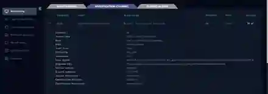

# SOC141 — Phishing URL Investigation

  

## Overview

This project investigates a **high-severity phishing URL alert** for user `ellie` on `EmilyComp` (`172.16.17.49`). The goal was to validate the URL, prove whether the endpoint actually reached it, determine whether credentials or malware activity could be confirmed, scope the event, and make a response decision based only on time-aligned evidence.

## Alert Summary

| Field | Value |
|---|---|
| Rule | `SOC141 - Phishing URL Detected` |
| Event ID | `86` |
| Host | `EmilyComp` |
| User | `ellie` |
| Destination | `mogagrocol.ru` / `91.189.114.8` |
| Action | Allowed |
| Severity | High |



## Investigation Logic

```text
Validate domain / URL
        ↓
Confirm endpoint access
        ↓
Review GET / POST and follow-on traffic
        ↓
Inspect endpoint activity
        ↓
Validate timestamps
        ↓
Scope domain / IP across environment
        ↓
Verdict and response
```

## Critical Evidence-Discipline Step

The endpoint process list contained suspicious-looking processes, but terminal history showed the relevant command activity occurred **more than a month before** the phishing alert. I excluded it from the incident rather than forcing a correlation.


## Findings

- VirusTotal classified the domain as malicious/phishing across multiple engines.
- Proxy and firewall telemetry confirmed the exact URL was requested from `EmilyComp`.
- The request was allowed.
- Only a GET was confirmed; no credential-submission POST was observed.
- No incident-time malware execution was confirmed.
- Scope searches identified only the observed endpoint in the available logs.

## Final Disposition

**True Positive — Phishing URL Accessed**

**Credential submission:** Not confirmed  
**Malware execution:** Not confirmed  
**Confirmed compromise:** No

The host was contained according to the exercise playbook, but the write-up deliberately separates confirmed access from unproven downstream impact.

## Skills Demonstrated

`Phishing Investigation` · `Proxy/Firewall Logs` · `Threat Intelligence` · `Endpoint Correlation` · `Timeline Validation` · `Scoping` · `Evidence-Based Reporting`
