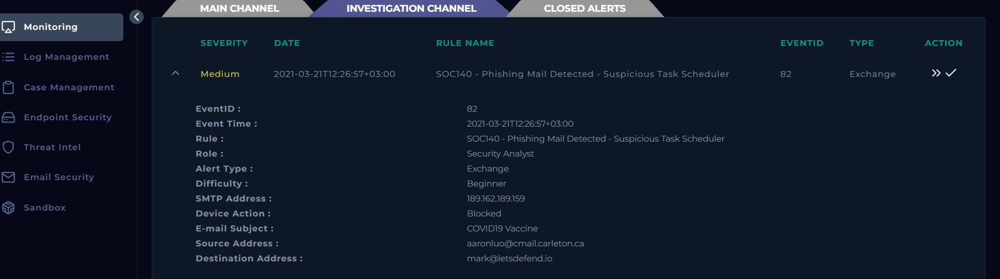
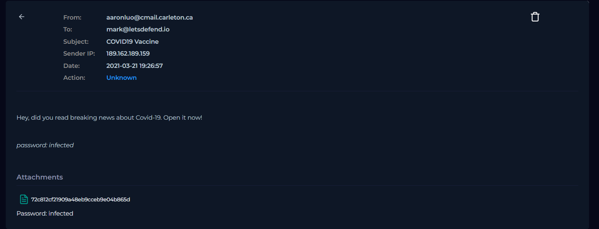
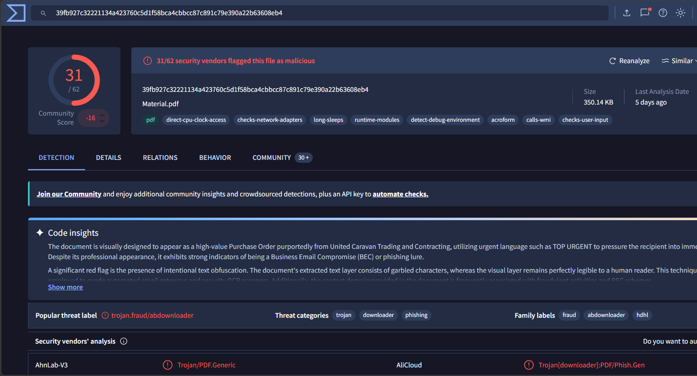
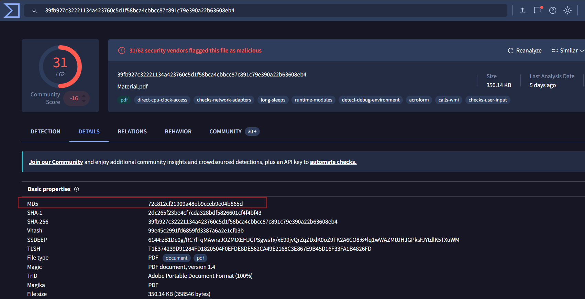
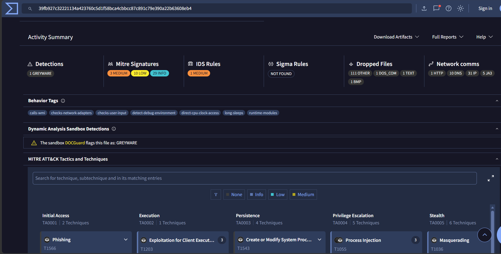
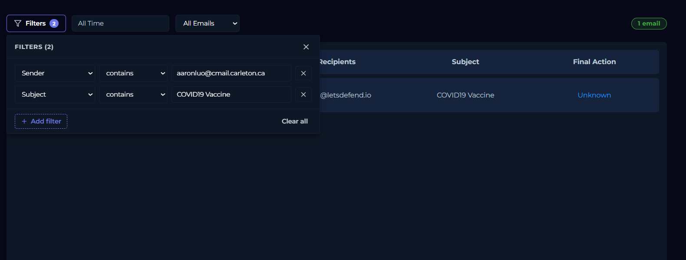

# SOC140 — Phishing Mail Detected — Suspicious Task Scheduler

## Phishing Attachment Investigation | LetsDefend EventID 82

This project documents my investigation of a **Medium-severity phishing email alert** involving a password-protected PDF attachment sent to `mark@letsdefend.io`.

The goal was not to repeat the alert title or simply complete the LetsDefend workflow. I treated the alert as an investigation hypothesis and worked through the questions a SOC analyst should ask: **Was the email really malicious? Was it delivered? What was inside the attachment? Did it execute? Is the “Suspicious Task Scheduler” behavior actually supported by evidence? Did the affected endpoint show follow-on activity? Was anyone else targeted?**

**Final verdict:** **True Positive — Malicious phishing email blocked before delivery**  
**Recipient:** `mark@letsdefend.io`  
**Sender:** `aaronluo@cmail.carleton.ca`  
**Malicious attachment:** `Material.pdf`  
**MD5:** `72c812cf21909a48eb9ccceb9e04b865d`  
**Email control action:** **Blocked**  
**Endpoint execution:** **Not confirmed**  
**Scheduled-task creation:** **Not independently confirmed**  
**Observed campaign scope:** **One matching sender + subject email**

---

# 1. Start With the Alert



## Alert summary

| Field | Value |
|---|---|
| Rule | `SOC140 - Phishing Mail Detected - Suspicious Task Scheduler` |
| Event ID | `82` |
| Severity | **Medium** |
| Event Time | `2021-03-21T12:26:57+03:00` |
| Alert Type | Exchange |
| SMTP Address | `189.162.189.159` |
| Device Action | **Blocked** |
| Subject | `COVID19 Vaccine` |
| Sender | `aaronluo@cmail.carleton.ca` |
| Recipient | `mark@letsdefend.io` |

### What mattered first

The two fields that immediately changed my investigation were:

```text
Suspicious phishing email
Device Action = Blocked
```

The rule name mentions **Suspicious Task Scheduler**, but an alert name is not proof that a scheduled task was successfully created. My first job was to separate the parts of the detection I could verify from the parts I could not.

The initial questions were:

> **Is this email actually malicious, and if it was blocked, is there any evidence the attachment still reached or executed on the endpoint?**

---

# 2. Analyst Decision Framework

I used a question-driven workflow rather than jumping directly to VirusTotal or assuming the alert title was correct.

| Question | Why it matters | Evidence I looked for |
|---|---|---|
| **1. What exactly was sent?** | Sender/subject alone are weak indicators | Email body, attachment, sender IP |
| **2. Was the message delivered?** | A blocked email has a different risk profile from a delivered email | Alert device action / mail action |
| **3. Is the attachment actually malicious?** | Password-protected files can be legitimate | Exact-hash reputation and file analysis |
| **4. What can the sample do?** | Reputation alone does not explain behavior | Sandbox / ATT&CK behavior |
| **5. Did it execute on Mark's host?** | Malicious attachment ≠ compromise | Endpoint processes, commands, network telemetry |
| **6. Was a scheduled task really created?** | The detection name is a hypothesis | `schtasks`, task telemetry, T1053 evidence |
| **7. Is there C2 or follow-on activity?** | Helps prove execution/impact | EDR network + proxy/firewall logs |
| **8. Was anyone else targeted?** | Scope changes severity and response | Sender/subject campaign search |
| **9. What conclusion is actually supported?** | Avoid overclaiming compromise | Correlated evidence + limitations |

My working flow became:

```text
Alert
  ↓
Open the email
  ↓
Identify and validate the attachment
  ↓
Confirm mail control action
  ↓
Review sample behavior
  ↓
Check endpoint execution / scheduled-task evidence
  ↓
Check network activity
  ↓
Scope sender + subject across environment
  ↓
Verdict → document limitations → close
```

---

# 3. Inspecting the Email

I pivoted to **Email Security** and found the message matching the alert sender, recipient and subject.



## Observation

```text
From:       aaronluo@cmail.carleton.ca
To:         mark@letsdefend.io
Subject:    COVID19 Vaccine
Sender IP:  189.162.189.159
Body:       "Hey, did you read breaking news about Covid-19. Open it now!"
Password:   infected
Attachment: 72c812cf21909a48eb9ccceb9e04b865d
```

The email body uses urgency and tells the user to open the content immediately. More importantly, the attachment is **password protected** and the password is supplied in the body.

### Why the password protection mattered

Password-protected archives/documents are not automatically malicious, but attackers frequently use them to reduce automated inspection by mail gateways. That made the attachment worth validating independently.

The value shown for the attachment was a 32-character hexadecimal string:

```text
72c812cf21909a48eb9ccceb9e04b865d
```

That format is consistent with an **MD5 hash**, so I used the hash as the pivot rather than relying on the displayed attachment name.

---

# 4. Was the Attachment Malicious?

I searched the exact attachment MD5 in VirusTotal.



## Finding

VirusTotal identified the sample as:

```text
Material.pdf
```

with **31/62 security vendors** flagging it as malicious.

Threat categories included:

```text
Trojan
Downloader
Phishing
```

The result was strong enough to classify the attachment as malicious rather than merely suspicious.

### Decision

> **The email contained a confirmed malicious PDF attachment.**

At this point, however, I still had not proven that Mark received or executed it.

---

# 5. Exact Hash Validation

I checked the file details to make sure the VirusTotal sample was the **same file** represented in the email, not just a similarly named PDF.



VirusTotal showed:

```text
MD5:    72c812cf21909a48eb9ccceb9e04b865d
SHA-1:  2dc265f23be4cf7cda328bdf5826601cf4f4bf43
SHA-256:39fb927c32221134a423760c5d1f58bca4cbbcc87c891c79e390a22b63608eb4
Type:   PDF document
Size:   350.14 KB
```

The MD5 exactly matched the attachment indicator from Email Security.

### Why this matters

This moved the case from:

```text
Suspicious attachment
```

to:

```text
Exact attachment hash → confirmed malicious PDF
```

That is a much stronger evidence chain.

---

# 6. Was the Email Delivered?

The alert reported:

```text
Device Action: Blocked
```

Email Security displayed the mail action as `Unknown`, so I did not use that UI field to contradict the explicit control result in the alert.

For incident handling, the strongest available delivery evidence was the alert's **Blocked** action.

### Decision

> **The malicious phishing email was blocked by the email security control and treated as not delivered.**

This is important because it changes the interpretation of everything seen later on `MarkPRD`.

If the message was blocked, I should **not** assume that a malicious process on the host came from this email without a strong timestamped correlation.

---

# 7. What Could the Malicious PDF Do?

I reviewed VirusTotal's behavioral/sandbox information for the exact sample.



The sample showed behavior associated with multiple ATT&CK techniques, including:

- **T1566 — Phishing**
- **T1203 — Exploitation for Client Execution**
- **T1543 — Create or Modify System Process**
- **T1547 — Boot or Logon Autostart Execution**
- **T1055 — Process Injection**
- **T1003 — OS Credential Dumping**
- **T1056 — Input Capture**
- **T1071 — Application Layer Protocol**
- **T1573 — Encrypted Channel**
- **T1485 — Data Destruction**

Behavior tags also included activity such as `calls-wmi`.

### What this proves — and what it does not

This proves the **sample itself has malicious capabilities** and provides context for why the mail rule fired.

It does **not** prove those behaviors occurred on `MarkPRD` in this incident.

That distinction matters:

```text
Sandbox capability ≠ endpoint execution evidence
```

---

# 8. Investigating the “Suspicious Task Scheduler” Part of the Alert

The alert title specifically references **Suspicious Task Scheduler**, so I tried to validate that behavior independently instead of repeating it as fact.

I checked the available sources for:

```text
schtasks.exe
Task Scheduler
Scheduled Task/Job (T1053)
terminal commands
time-stamped endpoint evidence
```

The available endpoint Terminal History had no relevant records, Log Management did not expose useful Windows scheduled-task telemetry for this host, and VirusTotal did **not** map this exact sample to **T1053 — Scheduled Task/Job** in the available sandbox results.

### Finding

> **Scheduled-task creation could not be independently confirmed from the available telemetry.**

This does not mean the detection was wrong. It means the evidence available to me did not support stating that a scheduled task was definitely created.

That is an important SOC habit: **the rule name is a starting hypothesis, not the final incident narrative.**

---

# 9. Endpoint Review — Avoiding a False Correlation

I identified `MarkPRD` (`172.16.17.88`) as the endpoint associated with the recipient context and reviewed its available process, terminal and network data.

The endpoint contained several process artifacts that looked suspicious in isolation, including activity already known from a later ransomware investigation on the same host.

However, the process view did not provide reliable event times, PIDs, parent processes or command lines for this SOC140 incident.

I therefore refused to use those artifacts as proof that the PDF executed.

### Why this mattered

The easy mistake would have been:

```text
Malicious PDF email
+ suspicious process on same host
= attachment executed
```

But without matching timestamps or causal context, that would be an unsupported correlation.

The better standard is:

```text
Same host + matching time + matching behavior + supporting telemetry
```

Only then should execution be attributed to the incident.

---

# 10. Network / C2 Check

MarkPRD's endpoint Network Action view had no usable telemetry for the relevant period.

I then searched centralized Log Management for the source IP:

```text
172.16.17.88
```

The available events were outside the SOC140 timeline, including older and later activity that did not match the March 21 alert.

I excluded those records rather than forcing them into the case.

### Finding

```text
Relevant C2 activity        = Not confirmed
Relevant payload download  = Not confirmed
Relevant endpoint network  = Not available
```

Again, absence of telemetry is not proof that nothing happened; it means the available data did not support a stronger conclusion.

---

# 11. Campaign Scope

I searched Email Security for the same sender and subject combination:

```text
Sender:  aaronluo@cmail.carleton.ca
Subject: COVID19 Vaccine
```



The search returned **one matching email**, to `mark@letsdefend.io`.

I also noted that the same sender address had appeared in other emails at different dates with different themes, but I did **not** automatically group them into the same campaign because the subjects and timelines differed.

### Scope finding

> **The exact observed SOC140 sender + subject combination targeted one recipient: Mark.**

---

# 12. Evidence Summary

| Question | Conclusion |
|---|---|
| Was the alert based on a real phishing email? | **Yes** |
| Was the attachment malicious? | **Yes — exact MD5 confirmed** |
| Was the message blocked? | **Yes — Device Action Blocked** |
| Was it delivered to Mark? | **Treated as not delivered** |
| Did the PDF execute on MarkPRD? | **Not confirmed** |
| Was a scheduled task created? | **Not independently confirmed** |
| Was C2/follow-on network activity observed? | **Not confirmed** |
| Did other users receive the same sender + subject email? | **Not observed** |
| Final verdict | **True Positive** |

---

# 13. Final Verdict

## True Positive — Malicious Phishing Email Blocked Before Delivery

The alert was assessed as a **True Positive** because:

```text
✓ Matching phishing email identified
✓ Password-protected attachment identified
✓ Attachment MD5 exactly matched a known malicious PDF
✓ 31/62 VirusTotal vendors flagged the sample
✓ Sample behavior showed malicious execution/persistence capabilities
✓ Email security alert recorded Device Action = Blocked
✓ Exact sender + subject scope was limited to one observed recipient
```

The available evidence did **not** support claiming successful endpoint compromise.

The defensible conclusion is:

> **A malicious phishing email containing a confirmed malicious PDF attachment was detected and blocked before delivery. No timestamped evidence confirmed attachment execution, scheduled-task creation, C2 activity, or endpoint compromise from this SOC140 event.**

---

# 14. Response / Remediation

Because the email was blocked, the immediate risk was significantly lower than a delivered-and-opened phishing attachment.

For a real SOC environment, I would still recommend:

- block the malicious attachment hash across email/EDR controls;
- review and block the sender if organizational context confirms it is unauthorized;
- investigate the SMTP/source IP `189.162.189.159` for related campaign activity;
- search mailboxes for the same sender, subject, hash, and similar themes;
- hunt endpoint telemetry for the MD5/SHA-256 in case the same sample arrived through another channel;
- monitor for behaviors associated with the sample rather than assuming the exact alert title occurred;
- preserve the email and attachment metadata for threat-intelligence and detection improvement.

Endpoint isolation would normally require stronger evidence of endpoint exposure/compromise than was available here, because the message was blocked before delivery.

---

# 15. Indicators / Artifacts

| Type | Indicator | Context |
|---|---|---|
| Email sender | `aaronluo@cmail.carleton.ca` | Sender of SOC140 phishing message |
| Sender domain | `cmail.carleton.ca` | Domain used by sender |
| SMTP/source IP | `189.162.189.159` | SMTP address from alert |
| Recipient | `mark@letsdefend.io` | Targeted mailbox |
| Subject | `COVID19 Vaccine` | Campaign subject |
| MD5 | `72c812cf21909a48eb9ccceb9e04b865d` | Malicious PDF attachment |
| SHA-1 | `2dc265f23be4cf7cda328bdf5826601cf4f4bf43` | VirusTotal file identifier |
| SHA-256 | `39fb927c32221134a423760c5d1f58bca4cbbcc87c891c79e390a22b63608eb4` | VirusTotal file identifier |
| Filename | `Material.pdf` | VirusTotal sample name |

---

# 16. Analyst Lessons Learned

## 1. Start with delivery status before assuming compromise

The alert said **Blocked**. That should shape the whole investigation. A blocked malicious email is still a True Positive, but it is not the same incident as a delivered attachment that executed.

## 2. Validate the exact file, not just the filename

The MD5 gave me a direct content-level pivot. The exact hash match made the malicious-file conclusion defensible.

## 3. Sandbox behavior is capability evidence

VirusTotal showed what the sample can do. I kept that separate from what I could prove happened on MarkPRD.

## 4. Do not let the rule name write the report

The alert contained “Suspicious Task Scheduler,” but I could not independently validate T1053/scheduled-task creation. I documented that limitation instead of presenting the detection label as observed fact.

## 5. Same host does not mean same incident

MarkPRD had other suspicious artifacts from different dates/incidents. Without time correlation, those artifacts should not be attached to this case.

## 6. A True Positive does not automatically mean compromise

This incident is a useful example:

```text
True Positive phishing
        ↓
Confirmed malicious attachment
        ↓
Blocked before delivery
        ↓
No confirmed endpoint execution
```

The detection was valid, while the impact remained limited based on the available evidence.

---

# 17. Reusable Phishing-Attachment Triage Framework

For future phishing attachment alerts, I would use this sequence:

```text
1. Read the alert
2. Identify sender, recipient, subject, time and control action
3. Open the message and inspect content/attachment/link
4. Validate attachment hash/reputation
5. Determine whether email was delivered or blocked
6. Check endpoint for execution only if exposure is possible
7. Correlate processes with timestamps/parent-child context
8. Check network/C2/download activity
9. Validate any specific detection behavior independently
10. Scope sender, subject, hash and related IOCs across users/endpoints
11. Classify impact separately from alert validity
12. Contain/remediate based on evidence
13. Document limitations and detection improvements
```

---

## Final Classification

**Verdict:** True Positive  
**Incident:** Malicious phishing email with malicious PDF attachment  
**Delivery:** Blocked / not delivered  
**Attachment:** Confirmed malicious  
**Execution:** Not confirmed  
**Scheduled task:** Not independently confirmed  
**C2:** Not confirmed  
**Observed scope:** One matching recipient  
**Compromise:** Not confirmed