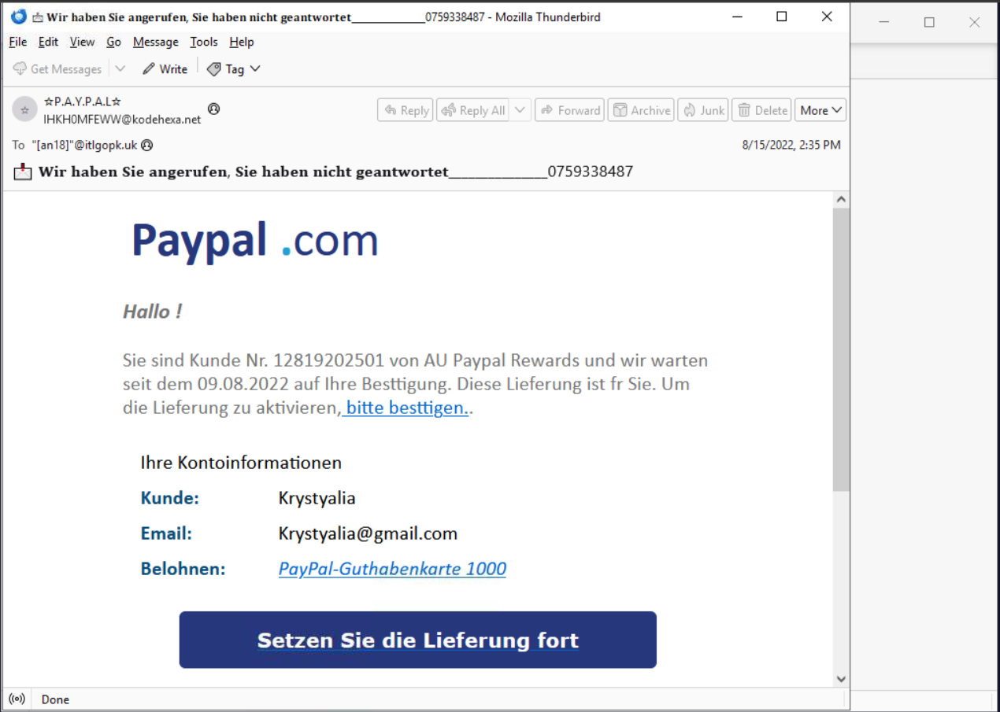
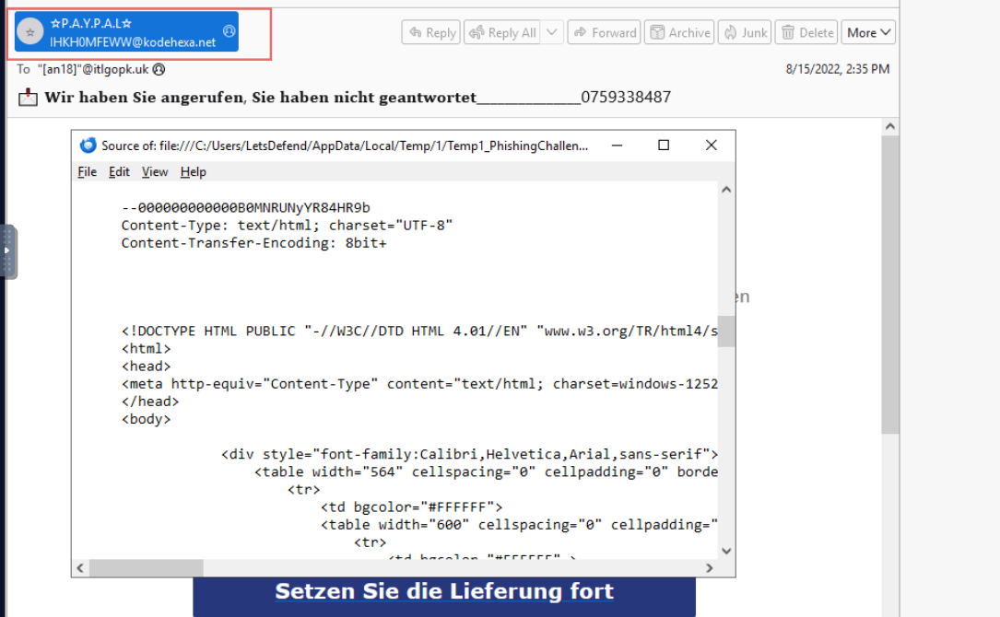
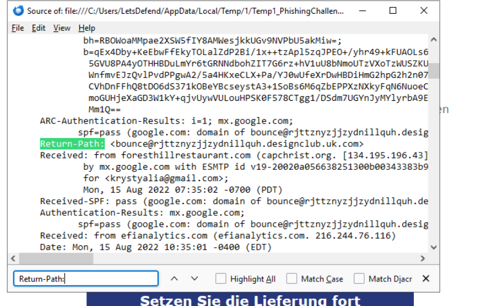
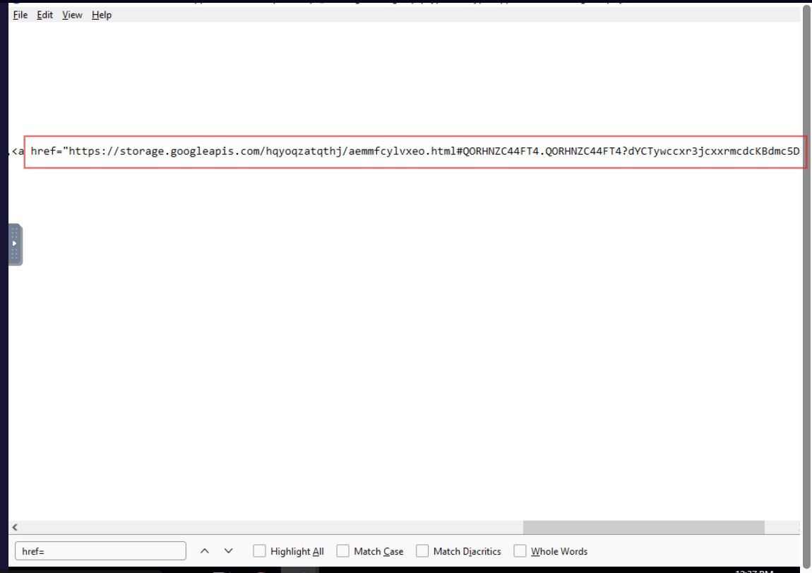
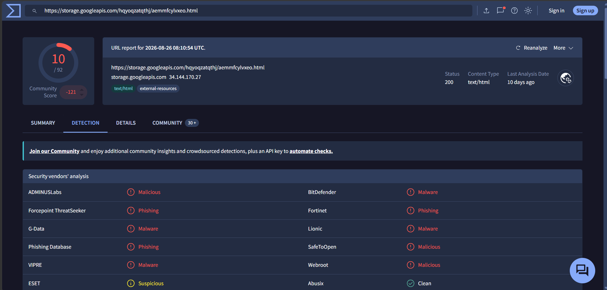
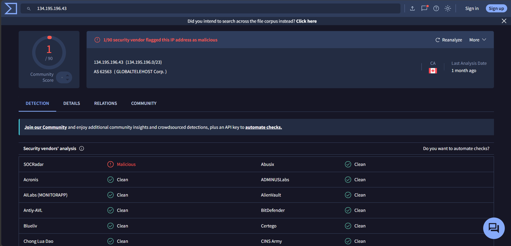

# Phishing Email Challenge — PayPal Brand Impersonation Investigation

## Investigation Overview

This project documents my analysis of a suspicious `.eml` file from the LetsDefend **Phishing Email** challenge. The email impersonated PayPal and attempted to direct the recipient to an external HTML page hosted on Google Cloud Storage.

I approached the message as a SOC analyst would: start with the email itself, validate the sender identity, trace the mail path, inspect authentication results, extract the real link without clicking it, enrich the URL and sending infrastructure, then correlate the evidence before making a verdict.

**Final verdict:** **Phishing — PayPal brand impersonation**  
**Confidence:** High

---

# 1. Initial Email Review



The challenge provided a suspicious PayPal-themed email. Before opening headers or checking reputation, I first looked at what the user would actually see.

### Observation

The email:

- used PayPal branding;
- presented a reward / delivery theme;
- encouraged the recipient to confirm or continue;
- used German text and a call-to-action link.

### Analyst reasoning

The branding alone did not prove anything. Attackers can copy logos, formatting and wording very easily.

My first question was:

> **Does the technical sender identity actually match the PayPal brand being presented?**

That determined my first pivot: inspect the sender address rather than judging the email by appearance.

---

# 2. Display Name vs Actual Sender



Thunderbird showed:

```text
Display name: *P.A.Y.P.A.L*
Actual sender: IHKH0MFEWW@kodehexa.net
```

### Why this mattered

The display name is controlled by the sender and can say almost anything. The actual address is more useful for validating identity.

The visible sender domain was:

```text
kodehexa.net
```

That does not align with PayPal.

### Finding

```text
Claimed brand      → PayPal
Actual From-domain → kodehexa.net
Identity alignment → No
```

This was my first strong phishing indicator, but I did not stop there. A mismatched From-domain is suspicious, not complete proof by itself.

### Next pivot

> **What does the raw SMTP header say about the true envelope sender and sending infrastructure?**

---

# 3. Raw Header Analysis

I opened the raw message source in Thunderbird using:

```text
More → View Source
```

or:

```text
Ctrl + U
```

Then I searched for the most useful header fields.



The key values were:

```text
Return-Path:
bounce@rjttznyzjjzydnillquh.designclub.uk.com

Received from:
foresthillrestaurant.com

Sending IP:
134.195.196.43

Received-SPF:
pass
```

### Analyst reasoning

At this point, the identity chain looked like this:

```text
Displayed brand → PayPal
Visible From    → kodehexa.net
Return-Path     → designclub.uk.com subdomain
Sending host    → foresthillrestaurant.com
Sending IP      → 134.195.196.43
```

None of those identities aligned with PayPal.

That made the email significantly more suspicious because the mismatch was no longer limited to one field.

---

# 4. Understanding the SPF Result Correctly

The header showed:

```text
SPF = pass
```

A common mistake would be to interpret this as:

> “SPF passed, therefore the email is legitimate.”

That is not what SPF proves.

### Why this mattered

SPF checks whether the sending IP is authorized to send mail for the domain being evaluated. In this message, the SPF result related to the unrelated envelope / Return-Path domain — not PayPal.

So the correct interpretation was:

> **The sender IP was permitted for the unrelated Return-Path domain. SPF did not authenticate the PayPal brand claim.**

I also searched for `dkim=` and `dmarc=` in the available message source. I did not find a usable DKIM or DMARC result, so I recorded that as unavailable evidence rather than claiming those checks failed.

### Next pivot

The sender identity was already inconsistent. I now needed to answer:

> **Where does the email actually send the user?**

---

# 5. Extracting the Real Link Safely

I did **not** click the visible button or link.

Instead, I searched the raw HTML source for:

```text
href=
```



The link was:

```text
https://storage.googleapis.com/hqyoqzatqthj/aemmfcylvxeo.html#QORHNZC44FT4.QORHNZC44FT4?dYCTywccxr3jcxxrmcdcKBdmc5D6qfcJVcbbb4M
```

The base resource was:

```text
https://storage.googleapis.com/hqyoqzatqthj/aemmfcylvxeo.html
```

The domain was:

```text
storage.googleapis.com
```

### Why this mattered

A PayPal email should not normally send a user to an unrelated Google Cloud Storage HTML page for account confirmation or rewards activity.

However, I did **not** classify `storage.googleapis.com` itself as malicious. It is a legitimate shared cloud service.

The suspicious part was the mismatch:

```text
Email claims PayPal
        ↓
Link does not go to paypal.com
        ↓
Link goes to a cloud-hosted HTML object
```

### Next pivot

> **Is this exact hosted page known to be malicious or phishing?**

That is more useful than judging the parent Google domain.

---

# 6. Exact URL Reputation

I searched the exact hosted page in VirusTotal.



VirusTotal showed:

```text
10 / 92 vendors flagged the exact URL
```

The classifications included:

```text
Phishing
Malicious
Malware
```

### Analyst reasoning

This was much stronger than saying “the link looks strange.”

The exact object embedded in the email had independent malicious / phishing reputation.

At this point, the evidence supported a phishing verdict because:

- the email impersonated PayPal;
- the sender infrastructure did not align with PayPal;
- the embedded link did not go to PayPal;
- the exact hosted page was flagged by multiple vendors.

### Finding

> **The exact URL embedded in the email was confirmed as suspicious / phishing by multiple reputation sources on VirusTotal.**

---

# 7. Sending IP Enrichment

The raw `Received:` / `Received-SPF:` information identified:

```text
134.195.196.43
```

as the mail-sending IP.

I enriched it in VirusTotal.



The result showed approximately:

```text
1 / 90 vendors flagged the IP
```

### Why this mattered

This was a useful lesson in evidence weighting.

One vendor detection is weak evidence. Shared hosting, historical abuse, stale data or false positives can all affect IP reputation.

So I did **not** write:

> “The sending IP is malicious.”

Instead, I treated it as low-confidence supporting context:

> **The sender IP had limited negative reputation, but the phishing verdict did not depend on that result.**

The stronger evidence remained the identity mismatches and the exact malicious URL.

---

# 8. Correlating the Evidence

The case became convincing because multiple independent observations pointed in the same direction:

```text
PayPal branding
      ↓
Actual sender = kodehexa.net
      ↓
Return-Path = unrelated designclub.uk.com subdomain
      ↓
Sending host = foresthillrestaurant.com
      ↓
SPF passes only for unrelated envelope domain
      ↓
Link destination = storage.googleapis.com hosted HTML object
      ↓
Exact hosted page = 10/92 phishing/malicious detections
```

No single field carried the whole verdict.

That is the main lesson from this investigation: **phishing analysis is correlation, not checkbox matching.**

---

# 9. Final Verdict

## Phishing — PayPal Brand Impersonation

The email was assessed as phishing with high confidence.

### Evidence supporting the verdict

```text
✓ PayPal display-name impersonation
✓ Actual sender domain did not match PayPal
✓ Return-Path did not match PayPal
✓ Sending host did not match PayPal
✓ SPF did not authenticate PayPal
✓ Embedded URL did not point to PayPal infrastructure
✓ Exact hosted HTML page was flagged by 10/92 vendors
✓ Sender-IP reputation was treated as weak supporting evidence only
```

### Final assessment

> **The message is a PayPal-themed phishing email using brand impersonation and an external cloud-hosted phishing page. The strongest evidence is the sender / infrastructure mismatch combined with malicious reputation for the exact embedded URL.**

---

# 10. What I Would Do in a SOC

If this email appeared in a production environment, my response would focus on the campaign-specific indicators rather than broadly blocking shared Google infrastructure.

Recommended actions:

- block the exact malicious URL / object;
- block or quarantine matching phishing messages;
- search mail logs for the same sender, Return-Path, subject and URL;
- identify other recipients;
- check whether any user clicked the URL;
- if clicked, investigate browser, proxy and endpoint telemetry;
- if credentials were entered, reset credentials and revoke active sessions;
- preserve the `.eml` and extracted IOCs for detection and hunting.

### Important blocking caution

I would **not** block all of:

```text
storage.googleapis.com
```

or the Google hosting IP simply because this phishing page was hosted there. Those are shared legitimate services and broad blocking could create unnecessary business impact.

---

# 11. Analyst Decision Trail

This is the investigation framework I followed and why each pivot mattered:

| Stage | Question I asked | Why it mattered | Result |
|---|---|---|---|
| Initial review | What does the email claim to be? | Establish the lure and claimed identity | PayPal impersonation |
| Sender validation | Does the actual sender match PayPal? | Display names can be spoofed | No — `kodehexa.net` |
| Header analysis | What is the Return-Path and sending host/IP? | Reveals SMTP delivery identity | Unrelated infrastructure |
| Authentication | Does SPF prove PayPal sent it? | Avoid treating SPF pass as legitimacy | No — pass was for unrelated domain |
| Link extraction | Where does the button really go? | Visible text cannot be trusted | Google Cloud hosted HTML page |
| URL enrichment | Is the exact object malicious? | Reputation on exact URL is stronger than parent-domain suspicion | 10/92 flagged |
| IP enrichment | Is sender IP malicious? | Adds context but must be weighted carefully | 1/90 only — weak evidence |
| Correlation | Do all findings support one explanation? | Prevents verdicts based on one indicator | High-confidence phishing |

---

# 12. Investigation Lessons / Mistakes to Avoid

## 1. Do not trust the display name

```text
Display name = branding
Actual address = technical identity
```

A message can say `PayPal`, `Microsoft`, `CEO`, or anything else in the display name.

## 2. Do not treat SPF pass as “safe”

SPF can pass for an attacker-controlled domain. Always ask:

> **Which domain actually passed SPF?**

## 3. Do not click links to discover where they go

Use the raw message source and search:

```text
href=
```

## 4. Do not call a whole cloud provider malicious

A malicious page hosted on Google Cloud does not make all of `storage.googleapis.com` malicious.

## 5. Do not over-weight one threat-intelligence result

```text
1 / 90 malicious
```

is weak evidence by itself.

The better approach is to correlate identity, headers, URL behavior and reputation.

---

# 13. Reusable Phishing Email Cheat Sheet

## Open the raw email source

In Thunderbird:

```text
More → View Source
```

or:

```text
Ctrl + U
```

Then use `Ctrl + F` to search the fields below.

| What I need | Search for | What it tells me |
|---|---|---|
| Visible sender | `From:` | Who the message claims to be from |
| Envelope sender | `Return-Path:` | SMTP return / bounce sender |
| Sending path | `Received:` | Servers and IPs that handled the message |
| Sender IP | `Received-SPF:` or earliest useful `Received:` | Mail-sending infrastructure |
| SPF | `Received-SPF:` or `spf=` | Whether the IP was authorized for the checked domain |
| DKIM | `dkim=` | Whether a cryptographic mail signature validated |
| DMARC | `dmarc=` | Whether authentication aligned with the visible From-domain |
| Reply destination | `Reply-To:` | Where replies would actually be sent |
| Real link | `href=` | Actual URL behind a button or text |
| Recipient | `To:` / `Delivered-To:` | Who was targeted |
| Subject | `Subject:` | Lure / campaign theme |
| Message ID | `Message-ID:` | Useful for hunting and correlation |

## How to find the Return-Path

Search:

```text
Return-Path:
```

Example:

```text
Return-Path: <bounce@example.com>
```

The answer is:

```text
bounce@example.com
```

Then compare its domain with the visible `From:` domain and claimed brand.

## How to find the domain from a URL

Example:

```text
https://storage.googleapis.com/folder/page.html?x=1#abc
```

Break it into:

```text
Protocol → https://
Domain   → storage.googleapis.com
Path     → /folder/page.html
Query    → ?x=1
Fragment → #abc
```

Easy rule:

> **The domain is the hostname after `http://` or `https://` and before the next `/`.**

## How to find the sender IP

Search for:

```text
Received-SPF:
```

or inspect the `Received:` chain.

Example:

```text
Received: from example-host.com (...) [134.195.196.43]
```

Possible sender IP:

```text
134.195.196.43
```

When there are multiple `Received:` lines:

```text
1. Read the chain from bottom to top
2. Ignore obvious internal Gmail/Microsoft relay hops
3. Find the earliest believable external hop
4. Extract the sending host/IP
```

## Fast phishing workflow

```text
Identity
  ↓
From / Display Name / Reply-To / Return-Path
  ↓
Authentication
  ↓
SPF / DKIM / DMARC
  ↓
Delivery Path
  ↓
Received headers / sender IP
  ↓
Content
  ↓
Urgency / impersonation / requests
  ↓
Links
  ↓
Extract href safely → domain → exact URL reputation
  ↓
Attachments
  ↓
Filename → type → hash → reputation / behavior
  ↓
Impact
  ↓
Did the user click, submit credentials or execute anything?
  ↓
Scope
  ↓
Who else received/accessed the same indicators?
  ↓
Verdict and response
```

### Evidence discipline reminders

```text
SPF pass                 ≠ message is legitimate
One vendor detection     ≠ definitely malicious
Shared cloud domain      ≠ whole domain is malicious
Displayed brand name     ≠ authenticated sender
Suspicious URL           ≠ user clicked it
User clicked page        ≠ credentials were submitted
Malicious attachment     ≠ attachment executed
```

---

# 14. Indicators and Artifacts

| Type | Indicator | Context |
|---|---|---|
| Display name | `*P.A.Y.P.A.L*` | Brand impersonation |
| Visible sender | `IHKH0MFEWW@kodehexa.net` | Actual From address shown by Thunderbird |
| Return-Path | `bounce@rjttznyzjjzydnillquh.designclub.uk.com` | SMTP envelope sender |
| Sending host | `foresthillrestaurant.com` | External mail-delivery hop |
| Sending IP | `134.195.196.43` | Sender infrastructure; weak VT reputation only |
| Phishing URL | `https://storage.googleapis.com/hqyoqzatqthj/aemmfcylvxeo.html` | Exact hosted page flagged by multiple vendors |
| URL domain | `storage.googleapis.com` | Legitimate shared cloud service abused for hosting |
| Hosting IP observed in VT | `34.144.170.27` | Shared Google infrastructure; not suitable for blanket blocking |

---

# 15. Skills Demonstrated

- `.eml` analysis in Thunderbird
- raw email-header inspection
- From / Return-Path comparison
- Received-header tracing
- SPF interpretation
- safe HTML link extraction
- URL decomposition
- phishing URL enrichment in VirusTotal
- sender-IP enrichment
- evidence weighting and correlation
- campaign IOC extraction
- phishing triage and response recommendations

---

## Final Classification

**Verdict:** Phishing  
**Technique:** PayPal brand impersonation / credential-phishing lure  
**Malicious URL:** Confirmed by multiple vendors  
**Sender identity alignment:** Failed / inconsistent with PayPal  
**SPF:** Passed for unrelated envelope domain, not proof of PayPal authenticity  
**Sending IP reputation:** Weak negative reputation only  
**Confidence:** High