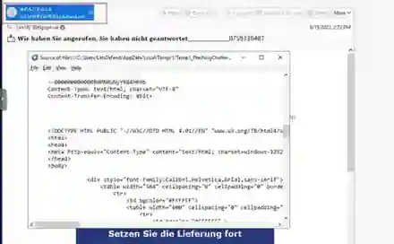

# PayPal Brand-Impersonation Phishing Investigation

  

## Overview

This project documents the analysis of a suspicious `.eml` file from a LetsDefend phishing-email challenge. The message visually impersonated PayPal and attempted to direct the recipient to an external HTML page hosted on Google Cloud Storage.

The investigation followed a SOC email-analysis workflow: inspect what the user sees, validate the real sender, trace SMTP headers, interpret authentication results correctly, extract the actual `href` without clicking it, enrich the URL and infrastructure, and correlate the evidence.

## Sender Identity

The message displayed the name `*P.A.Y.P.A.L*`, but the actual visible sender was:

```text
IHKH0MFEWW@kodehexa.net
```



The raw headers also showed a Return-Path unrelated to PayPal. SPF passed for that unrelated Return-Path domain, which is an important distinction: **SPF pass does not mean “this is really PayPal.”** It means the sending infrastructure was authorised for the domain that SPF evaluated.

## URL Analysis

The real link was extracted from the HTML `href` rather than clicked. The destination was an HTML page hosted under `storage.googleapis.com`. The exact URL was detected as phishing/malicious by multiple VirusTotal engines.


## Findings

- Claimed PayPal identity did not align with the actual From-domain.
- Envelope sender / Return-Path was also unrelated to PayPal.
- SPF authenticated an unrelated domain and therefore did not establish PayPal legitimacy.
- The true hyperlink was safely extracted from the message source.
- The exact hosted page had strong phishing reputation.
- The shared Google hosting domain/IP itself was not treated as globally malicious infrastructure.

## Final Disposition

**Phishing — PayPal Brand Impersonation**  
**Confidence:** High

## Key Lessons

- Display name ≠ authenticated identity.
- SPF pass ≠ legitimate brand identity.
- Extract `href=` rather than clicking links.
- Judge shared-cloud infrastructure carefully; block the malicious resource, not an entire cloud provider.
- Exact-URL reputation is stronger evidence than a single low-confidence IP detection.

## Skills Demonstrated

`Email Header Analysis` · `SPF` · `Return-Path` · `URL Extraction` · `Threat Intelligence` · `Brand Impersonation` · `Phishing Triage`
