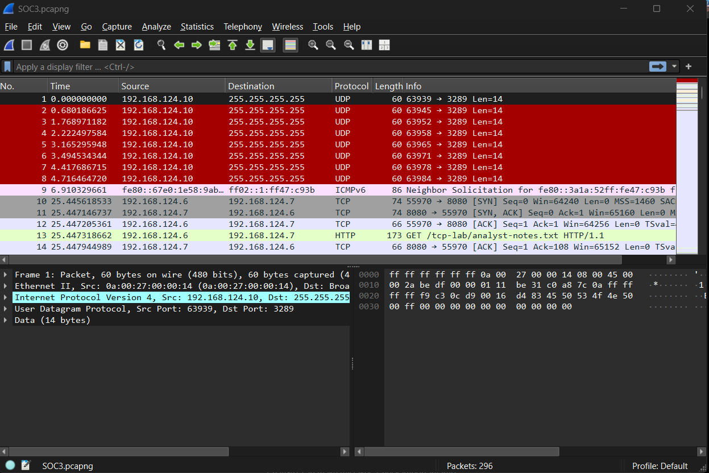
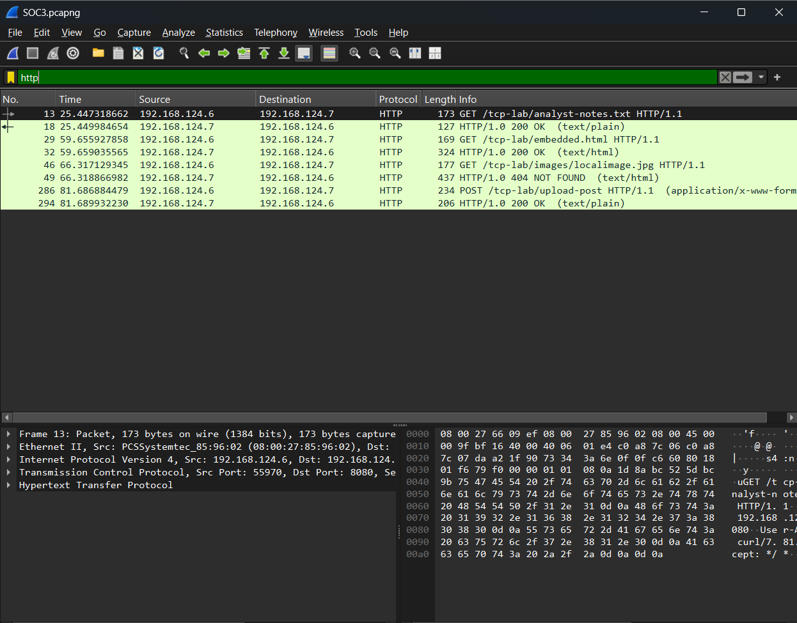
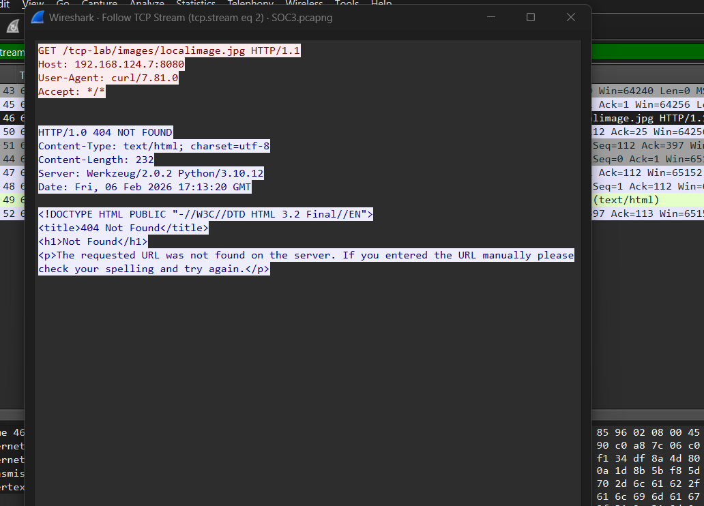
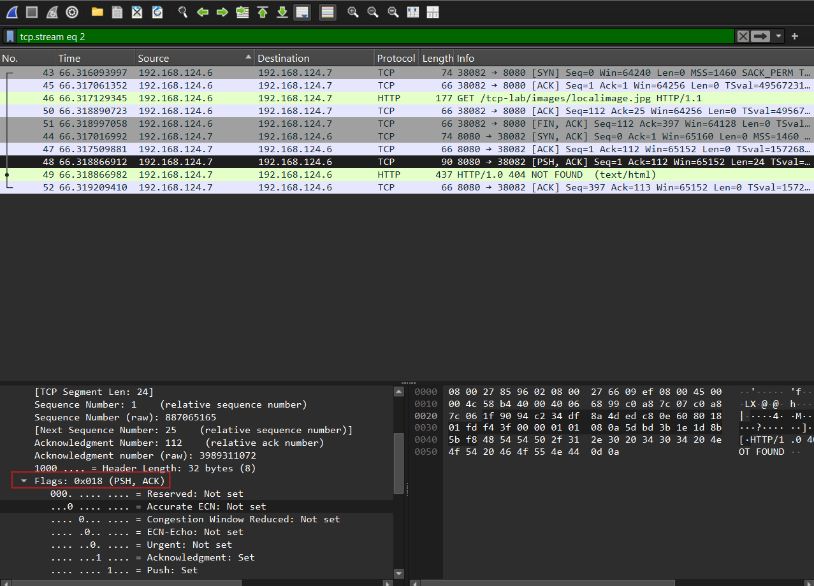
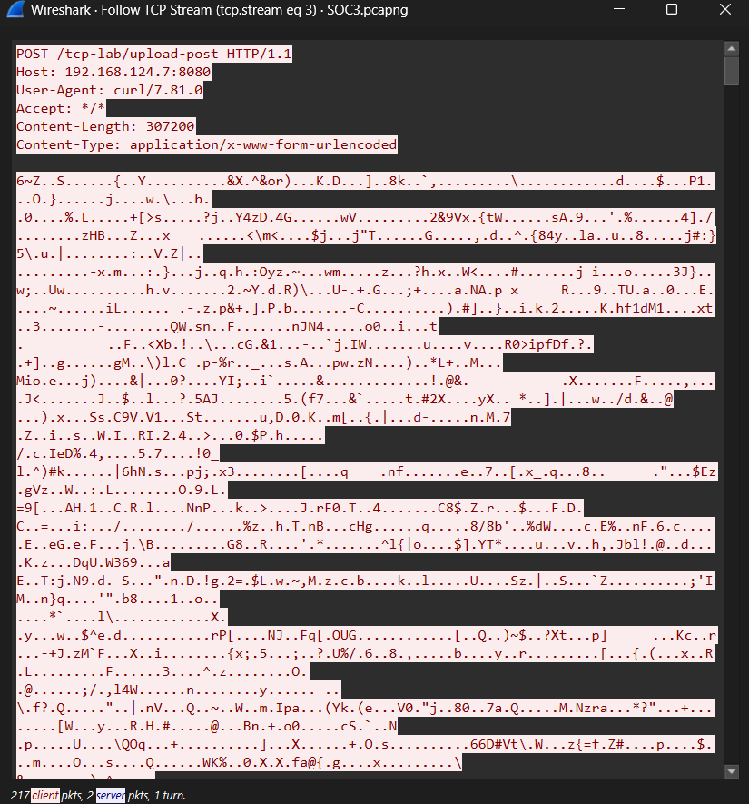
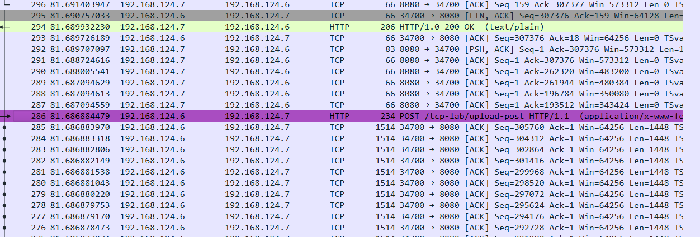
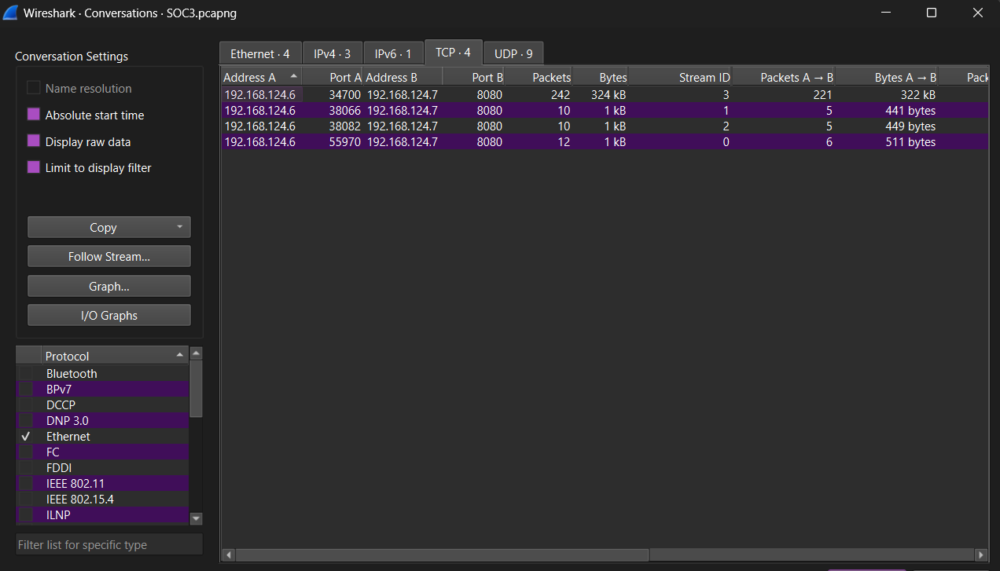

# Wireshark SOC Network Traffic Investigation

## PCAP Analysis | HTTP, TCP Streams, Data Transfer and Impact

This project documents my analysis of the **SOC3 PCAP** in Wireshark using a SOC-style investigation workflow. The objective was not to search for a single "bad packet" or complete a worksheet. I wanted to answer the questions an analyst should be able to defend with packet evidence:

> **What actually happened? How do I know? What data moved? What was the impact? Is the behavior normal or abnormal? Does it need escalation?**

The capture contained **296 packets** and several small HTTP/TCP conversations between internal hosts. One conversation stood out because it carried a much larger client-to-server transfer than the others.

### Final assessment

**Observed activity:** HTTP client/server traffic between `192.168.124.6` and `192.168.124.7:8080`, including successful GET requests, one failed image request, and a large HTTP POST upload.

**Largest transfer:** approximately **307,200 bytes of HTTP body data** / roughly **322 kB client → server at the TCP conversation level**.

**Evidence of successful transfer:** payload-bearing TCP segments, receiver acknowledgments, HTTP `200 OK`, and normal TCP teardown.

**Malicious verdict:** **Not established from this PCAP alone.** The large POST is an impact/volume outlier and deserves investigation, but a large upload is not automatically malicious.

---

# 1. Start Broad — What Is in the Capture?



I opened the PCAP without immediately filtering for an answer.

## Observation

The capture contained **296 packets**. At a glance I could see:

- repeated UDP broadcast traffic from `192.168.124.10`
- TCP communication between `192.168.124.6` and `192.168.124.7`
- HTTP traffic to port `8080`
- an HTTP request for `/tcp-lab/analyst-notes.txt`

## Why this mattered

The first task in packet analysis is to establish the environment before chasing individual packets. Repeated broadcasts may be background noise, while established client/server conversations are more likely to explain meaningful application activity.

My initial questions were:

- What protocols are present?
- Which hosts are communicating?
- Which traffic is background noise?
- Which conversations carry meaningful data?
- Is there an obvious volume or direction outlier?

The working approach became:

```text
PCAP
  ↓
Understand protocols and hosts
  ↓
Reduce noise
  ↓
Identify meaningful conversations
  ↓
Inspect HTTP request/response behavior
  ↓
Follow TCP streams
  ↓
Validate whether data actually moved
  ↓
Measure volume, direction and completion
  ↓
Assess impact and decide whether escalation is justified
```

---

# 2. Reduce Noise With HTTP



I applied the display filter:

```wireshark
http
```

This reduced the capture to the application-layer HTTP events that were easiest to reason about.

## HTTP activity observed

| Client request | Server response | Initial interpretation |
|---|---|---|
| `GET /tcp-lab/analyst-notes.txt` | `200 OK` | Resource successfully returned |
| `GET /tcp-lab/embedded.html` | `200 OK` | Resource successfully returned |
| `GET /tcp-lab/images/localimage.jpg` | `404 NOT FOUND` | Request occurred, requested image was not obtained |
| `POST /tcp-lab/upload-post` | `200 OK` | Client submitted data and server accepted/processed the HTTP request |

## Analyst question

> **Did I merely observe requests, or did the requested/submitted content actually transfer?**

That question became central to the rest of the investigation.

---

# 3. Request Does Not Equal Success — 404 Example



I followed the stream for:

```http
GET /tcp-lab/images/localimage.jpg HTTP/1.1
Host: 192.168.124.7:8080
User-Agent: curl/7.81.0
```

The server answered:

```http
HTTP/1.0 404 NOT FOUND
Content-Length: 232
Server: Werkzeug/2.0.2 Python/3.10.12
```

## Observation → reasoning

**Observation:** The client requested `localimage.jpg`.

**Why it mattered:** A GET request proves intent to retrieve a resource, but not that the resource was successfully downloaded.

**Finding:** The server returned `404 NOT FOUND`.

**Conclusion:** The image itself was **not transferred**. The `232` bytes in the response were the HTML error page, not the requested image.

This produced a reusable rule:

> **Request seen ≠ requested content successfully obtained. Always inspect the response.**

---

# 4. Identify Client and Server From Behavior — Not Colour

Wireshark's **Follow TCP Stream** view uses two colours to show the two traffic directions. The colour is useful visually, but I should not memorize:

```text
red = client
blue = server
```

as a universal rule.

The reliable way to identify roles is to use the traffic itself:

- who initiated the TCP connection with the first `SYN`
- who sent the application request
- which side is using the service/listening port
- which side returns the application response

In this PCAP:

```text
192.168.124.6:<ephemeral port> → 192.168.124.7:8080
```

`192.168.124.6` acts as the HTTP client and `192.168.124.7:8080` acts as the server.

### Follow Stream colour lesson

> **Red and blue mean opposite directions in that stream. Determine client/server from SYN, ports, requests and responses — not colour alone.**

The packet counts displayed at the bottom of Follow Stream are also context for how much activity occurred in each direction; they are not a substitute for determining which packets carry payload.

---

# 5. TCP Flags Tell the Conversation Story



Instead of treating packets as isolated rows, I read the TCP flags as stages of a conversation:

```text
SYN
  ↓
Connection requested

SYN, ACK
  ↓
Server accepts and acknowledges

ACK
  ↓
Three-way handshake complete

PSH, ACK + TCP payload
  ↓
Application data moving while previous data is acknowledged

ACK
  ↓
Receiver confirms bytes received

FIN, ACK
  ↓
Graceful connection teardown

RST
  ↓
Immediate/abnormal reset
```

## Important distinction about PSH

`PSH` itself does **not** mean "this is the payload." The stronger evidence is:

```text
TCP Segment Len > 0
```

or the filter:

```wireshark
tcp.len > 0
```

`PSH` tells TCP to deliver buffered data to the application promptly; `tcp.len > 0` confirms that TCP payload is actually present.

---

# 6. Sequence Numbers — Relative vs Raw

The packet details showed both a Wireshark-friendly sequence number and the actual raw TCP value, for example:

```text
Sequence Number:       1        (relative)
Sequence Number (raw): 887065165
```

## Why this mattered

Wireshark normally displays **relative sequence numbers** so a stream is easier to follow. The first sequence in a conversation may therefore appear as `0` or `1` even though the real on-the-wire value is a large number.

This means:

```text
Relative Seq = Wireshark normalization for readability
Raw Seq      = actual value sent in the TCP header
```

### Analyst questions

- Am I looking at relative or raw sequence numbers?
- Does the next sequence number advance by the amount of payload sent?
- Do ACK values correspond to the bytes the receiver should have received?
- Are there retransmissions or gaps?
- Across **independent new TCP connections**, do the raw initial sequence numbers look unusually repeated or mechanically predictable?

Modern TCP stacks normally randomize initial sequence numbers. If **raw initial sequence numbers repeat or appear highly predictable across separate connections**, that is unusual and deserves investigation because it may indicate synthetic/crafted traffic, an unusual TCP implementation, or another abnormal source.

However:

> **Repeated relative sequence numbers are not suspicious — Wireshark intentionally normalizes each new stream.**

And even repeated/predictable raw values are an **indicator to investigate**, not proof of malicious activity by themselves.

A key lesson from the lab was:

> **Wireshark displays what the endpoints placed on the wire. If packet behavior is strange, ask what host/tool generated it rather than blaming Wireshark.**

---

# 7. TCP Window — Performance Context Before Guessing

The same TCP details showed a receive window similar to:

```text
Window: 509
Window scaling factor: 128
Calculated window size: 65152 bytes
```

## My question

> **Is the connection behaving strangely because of security activity, or can ordinary TCP performance explain it?**

The receive window tells me how much additional data the receiver is prepared to accept. In this stream the calculated window remained reasonably large and there was no obvious Zero Window behavior, so I did not see evidence that the receiver was struggling to keep up.

### Healthy-looking context

- receive window remains reasonably large/stable
- no `Zero Window`
- no obvious repeated retransmission pattern
- data continues flowing

### Performance problems worth checking

- shrinking receive window
- `Zero Window`
- repeated `Window Update`
- retransmissions
- duplicate ACKs
- long stalls/delays

This avoids guessing that slow or strange-looking traffic must be malicious when the TCP mechanics may already explain it.

---

# 8. Large HTTP POST — Did Data Actually Move?



The most significant HTTP event was:

```http
POST /tcp-lab/upload-post HTTP/1.1
Host: 192.168.124.7:8080
User-Agent: curl/7.81.0
Content-Length: 307200
Content-Type: application/x-www-form-urlencoded
```

## Observation

The request specified a body of:

```text
307,200 bytes
```

and Follow TCP Stream displayed a large application payload rather than only an HTTP request line.

## Why this mattered

A `POST` tells me that a client is submitting data, but impact analysis requires more:

> **Can I prove meaningful bytes actually crossed the network?**

I therefore looked for:

1. application `Content-Length`
2. payload-bearing TCP segments
3. receiver ACKs
4. HTTP response
5. normal/abnormal connection completion

---

# 9. Count Segments Correctly — What Counts as Data?



The POST was not one giant packet. TCP split the application data into many segments.

Multiple client-to-server packets showed approximately:

```text
Len=1448
```

which represented real TCP payload carrying portions of the upload.

## Why segment counting matters in SOC analysis

Two events can both contain a `POST`, but have very different impact:

```text
Case A
POST
2 payload segments
3 KB total

Case B
POST
200+ payload-bearing segments
~300 KB total
```

The method is the same, but the amount of data and potential impact are materially different.

Segment count helps answer:

- Was this a tiny request or substantial transfer?
- How many packets actually carried data?
- Were bytes acknowledged?
- Was the transfer continuous or heavily fragmented into unusual tiny chunks?
- Were there retransmissions/loss?
- Was the stream successfully reassembled?

## What I count as unique upload data

Useful filter:

```wireshark
tcp.stream eq 3 && ip.src == 192.168.124.6 && tcp.len > 0
```

Do **not** count these as additional unique uploaded bytes:

- `SYN`
- `SYN, ACK`
- pure `ACK` with `Len=0`
- `FIN`
- `RST`
- duplicate ACKs
- retransmitted copies of bytes already sent

Retransmissions are still important for performance/reliability analysis, but they are repeated bytes rather than new application data.

### Where to stop

For **upload size**, stop at the final unique client payload segment.

For the **full TCP story**, continue through the server response and teardown until the conversation ends with `FIN/ACK` or `RST`.

In this stream I observed:

```text
Client payload segments
  ↓
Server ACKs the received byte ranges
  ↓
HTTP/1.0 200 OK
  ↓
FIN, ACK
  ↓
Connection closes normally
```

This provided much stronger impact evidence than simply saying "I saw a POST."

---

# 10. Conversations — Quantify the Outlier



I used:

```text
Statistics → Conversations → TCP
```

The TCP conversation table made the volume difference obvious.

## Stream 3

```text
192.168.124.6:34700 → 192.168.124.7:8080
242 packets total
~324 kB total
221 packets A → B
~322 kB A → B
```

The other TCP streams were only around **1 kB** each.

## Analyst reasoning

**Observation:** One conversation moved dramatically more data than every other TCP conversation.

**Question:** Why is Stream 3 so asymmetric and large?

**Pivot:** Correlate the stream with HTTP.

**Finding:** Stream 3 contained the `POST /tcp-lab/upload-post` request with a `Content-Length` of `307200`.

**Conclusion:** The volume outlier was explained by a substantial client-to-server HTTP upload.

This does **not** make the traffic malicious. It identifies the conversation with the greatest impact and tells me where to focus.

### Conversations vs payload packets

`Statistics → Conversations` counts the whole TCP conversation, including control traffic such as handshake, ACKs and teardown.

The filter:

```wireshark
tcp.len > 0
```

is what I use when I specifically want packets carrying TCP payload.

Therefore:

> **Conversations tells me how large and asymmetric a stream is. `tcp.len > 0` tells me which segments actually carry application data.**

---

# 11. Questions I Asked — and the Evidence-Based Answers

| SOC question | Answer from this PCAP |
|---|---|
| **What actually happened?** | Internal client `192.168.124.6` communicated with web server `192.168.124.7:8080`, made several HTTP requests and later sent a large POST upload. |
| **Who initiated the TCP conversations?** | `192.168.124.6` initiated the observed HTTP connections to the service on `192.168.124.7:8080`. |
| **Who is client/server?** | Client/server was determined from SYN direction, ephemeral → service port, HTTP request and response direction — not Follow Stream colours. |
| **What resources were requested?** | `analyst-notes.txt`, `embedded.html`, `images/localimage.jpg`, and `/upload-post`. |
| **Did every request succeed?** | No. `localimage.jpg` returned `404 NOT FOUND`; other HTTP requests returned `200 OK`. |
| **Did actual data move?** | Yes. The large POST had a `Content-Length` of `307200` and was carried over many payload-bearing TCP segments. |
| **Which direction carried the large transfer?** | Primarily `192.168.124.6 → 192.168.124.7`. |
| **Was the data acknowledged?** | Yes. Server ACKs progressed through the uploaded byte ranges. |
| **Did the application accept the POST?** | The server returned `HTTP/1.0 200 OK`, indicating successful HTTP-level processing of the request. |
| **Did the TCP conversation close normally?** | Yes. The stream progressed to `FIN/ACK` rather than an abrupt reset. |
| **Was the connection obviously congested?** | No clear evidence. The receive window remained reasonably large/stable and the observed transfer progressed normally. |
| **What did sequence numbers add?** | They helped verify byte progression and ACK behavior. Raw sequence values are actual TCP values; relative numbers are Wireshark normalization. |
| **Would repeated sequence numbers be suspicious?** | Repeated **relative** values across streams are normal. Repeated/highly predictable **raw initial sequence numbers across independent connections** are unusual and worth investigating. |
| **What was the largest conversation?** | Stream 3: about `324 kB` total, with roughly `322 kB` client → server. |
| **Is the large POST malicious?** | Not established. It is a significant volume/direction outlier, but size or POST method alone does not prove malicious behavior. |
| **What is the impact?** | A substantial client-to-server transfer occurred and was successfully acknowledged/processed at TCP/HTTP level. |
| **Escalate or close?** | From this isolated training PCAP alone, there is insufficient evidence to call the transfer malicious. In a real SOC I would escalate/hunt further if the upload were unexpected, contained sensitive data, or went to an untrusted destination. |

---

# 12. Important Mistakes / Traps to Avoid

## 1. "I saw a GET, so the file downloaded"
Wrong. Check the response. A `404` proves the request happened but the requested resource was not obtained.

## 2. "I saw POST, therefore exfiltration"
Wrong. POST proves data submission behavior. Determine size, direction, destination, context and whether the bytes actually moved.

## 3. "Red is always client and blue is always server"
Wrong. Follow Stream colours represent directions. Identify roles from connection/request behavior.

## 4. "Sequence number 0/1 means the endpoint generated predictable TCP"
Wrong. Wireshark normally shows relative sequence numbers. Inspect **raw** sequence numbers before making that judgment.

## 5. "Large packet count means malicious"
Wrong. Large legitimate transfers naturally need many segments. Compare against baseline and application context.

## 6. "Every packet in the stream is uploaded data"
Wrong. ACKs, SYNs, FINs and retransmissions are part of TCP but are not new unique application bytes.

## 7. "Slow/weird traffic must be malicious"
Wrong. Check windows, retransmissions, ACK behavior and other TCP performance indicators first.

## 8. "200 OK proves the business action succeeded"
Too strong. It proves the HTTP request was accepted/processed successfully at the application protocol level. It does not necessarily prove what the application ultimately did with the submitted data.

---

# 13. Reusable SOC Network Investigation Cheat Sheet

## Initial mindset

- [ ] What actually happened?
- [ ] What evidence proves it?
- [ ] What was the impact?
- [ ] Is this normal or abnormal?
- [ ] Does this need escalation?

## PCAP triage

- [ ] What protocols are present?
- [ ] Which hosts are communicating?
- [ ] Which conversations matter?
- [ ] What is background noise?
- [ ] Which conversation is a volume/direction outlier?

## Client/server roles

- [ ] Who sent the initial SYN?
- [ ] Which side uses the service port?
- [ ] Who sent the application request?
- [ ] Who returned the response?
- [ ] Am I incorrectly relying on red/blue colours?

## HTTP

- [ ] GET, POST, PUT or other method?
- [ ] What resource/URI?
- [ ] Host?
- [ ] User-Agent?
- [ ] Content-Length?
- [ ] What response code?
- [ ] Did requested content actually transfer?

## TCP

- [ ] Three-way handshake complete?
- [ ] What do SYN/ACK/PSH/FIN/RST tell me?
- [ ] `tcp.len > 0` — is there real payload?
- [ ] Are sequence and ACK numbers progressing correctly?
- [ ] Am I viewing relative or raw sequence numbers?
- [ ] Any retransmissions/duplicate ACKs/gaps?
- [ ] Receive window stable or shrinking?
- [ ] Zero Window / Window Update?
- [ ] Normal FIN teardown or RST?

## Transfer / segment counting

- [ ] How many payload-bearing segments?
- [ ] How many unique bytes moved?
- [ ] Which direction?
- [ ] Were bytes acknowledged?
- [ ] Were segments normal-sized or unusually tiny/chunked?
- [ ] Separate retransmissions from unique bytes.
- [ ] For upload size, stop at final unique client payload.
- [ ] For whole stream, continue through `FIN/ACK` or `RST`.

## Impact

- [ ] Connection only, or meaningful data transfer?
- [ ] Upload/download?
- [ ] How much data?
- [ ] Did the application return success?
- [ ] Is volume/direction normal for this user/application?
- [ ] What evidence proves the impact?

## Final decision

- [ ] What happened?
- [ ] How do I prove it?
- [ ] What systems were involved?
- [ ] What data direction/volume was involved?
- [ ] How severe is the impact?
- [ ] What evidence is missing?
- [ ] Escalate, hunt further, or close?

---

# 14. Short Version to Memorise

```text
WHAT HAPPENED?
        ↓
WHO TALKED TO WHO?
        ↓
WHO INITIATED IT?
        ↓
WHAT PROTOCOL / REQUEST?
        ↓
WHAT RESPONSE?
        ↓
DID DATA ACTUALLY MOVE?
        ↓
HOW MANY UNIQUE BYTES / PAYLOAD SEGMENTS?
        ↓
WHICH DIRECTION?
        ↓
WERE THE BYTES ACKNOWLEDGED?
        ↓
DID THE APPLICATION RETURN SUCCESS?
        ↓
DID TCP COMPLETE NORMALLY?
        ↓
DO PERFORMANCE MECHANICS EXPLAIN ANY WEIRDNESS?
        ↓
IS THIS NORMAL FOR THE ENVIRONMENT?
        ↓
WHAT IS THE IMPACT?
        ↓
ESCALATE OR CLOSE?
```

---

## Tools / Filters Used

```wireshark
http
```

```wireshark
tcp.stream eq 3
```

```wireshark
tcp.stream eq 3 && tcp.len > 0
```

```wireshark
tcp.stream eq 3 && ip.src == 192.168.124.6 && tcp.len > 0
```

Useful Wireshark views:

```text
Statistics → Protocol Hierarchy
Statistics → Conversations → TCP
Right-click packet → Follow → HTTP Stream
Right-click packet → Follow → TCP Stream
```

---

## Skills Demonstrated

- Wireshark PCAP triage
- HTTP request/response analysis
- TCP handshake and teardown analysis
- TCP flags and payload interpretation
- relative vs raw TCP sequence-number analysis
- ACK/byte-progression reasoning
- receive-window/performance context
- TCP stream following and reassembly
- segment counting and transfer validation
- conversations/volume/direction analysis
- evidence-based impact assessment
- avoiding overclaiming from isolated indicators